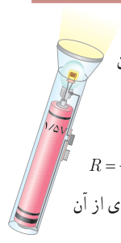
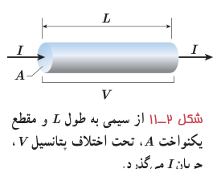

### مثال ۲ـ۲

یک لامپ چراغ قوۀ کوچک از یک باتری $1.5\ \mathrm V$، جریانی برابر $0.30\ \mathrm A$ می‌کشد. با فرض آنکه رشتۀ لامپ، یک رسانای اهمی باشد، الف) مقاومت آن چقدر است؟ ب) اگر باتری ضعیف شود و ولتاژ به $1.2\ \mathrm V$ افت کند، جریان چقدر می‌شود؟ از تغییر مقاومت رشتۀ لامپ در اثر تغییر دما چشم‌پوشی می‌شود.

**پاسخ:** الف) با استفاده از رابطۀ ۲ـ۲ برای مقاومت رشتۀ لامپ داریم:

$$R=\frac VI=\frac{1.5\ \mathrm V}{0.30\ \mathrm A}=5.0\ \Omega$$

ب) دوباره از رابطۀ ۲ـ۲ استفاده می‌کنیم. با توجه به اینکه اکنون مقاومت رشتۀ لامپ را داریم، جریان عبوری از آن چنین می‌شود:

$$I=\frac VR=\frac{1.2\ \mathrm V}{5.0\ \Omega}=0.24\ \mathrm A$$

## ۲ـ۳ عوامل مؤثر بر مقاومت الکتریکی

در بخش قبل پیش‌بینی کردیم که مقاومت الکتریکی یک سیم رسانا به طول و سطح مقطع آن و نیز ترکیب و ساختار آن بستگی دارد. آزمایش و محاسبات نظری نشان می‌دهد اگر سطح مقطع جسم در تمام طول آن یکسان باشد (شکل ۲ـ۱۱)، مقاومت آن از رابطۀ زیر به‌دست می‌آید:

$$R=\rho\frac LA\qquad (۲-۳)$$

که در آن طول رسانا ($L$) برحسب متر (m)، مساحت مقطع جسم ($A$) برحسب متر مربع ($\mathrm{m^2}$)، و مقاومت جسم ($R$) برحسب اهم ($\Omega$) است، و بنابراین، کمیت $\rho$ که به آن مقاومت ویژه گفته می‌شود برحسب اهم‌ـ‌متر ($\Omega\cdot\mathrm m$) می‌شود. این بستگی مقاومت به طول و مساحت مقطع جسم را می‌توان با شبیه‌سازی‌های ساده‌ای نیز درک کرد. هرچه جسم بلندتر شود الکترون‌ها هنگام عبور از آن برخوردهای بیشتری با اتم‌ها پیدا می‌کنند. بنابراین، مقاومت الکتریکی جسم بیشتر می‌شود. کوچک‌تر شدن سطح مقطع جسم را نیز می‌توان به کوچک‌تر شدن سطح مقطع لوله‌ای تشبیه کرد که در آن شاره‌ای در جریان است. کوچک‌تر شدن مقطع سبب کاهش عبور شاره می‌شود که به‌معنای افزایش مقاومت در برابر عبور شاره است.

مقاومت ویژۀ یک ماده به ساختار اتمی و دمای آن بستگی دارد. رساناهای الکتریکی خوب مقاومت ویژۀ بسیار کم و عایق‌های خوب مقاومت ویژۀ بسیار زیادی دارند. جدول ۲ـ۲ مقاومت ویژۀ برخی مواد را در دمای ۲۰°C نشان می‌دهد. همان‌طور که این جدول نشان می‌دهد دسته‌ای از مواد مانند ژرمانیم و سیلیسیم نیز وجود دارند که مقاومت ویژۀ آنها بین مقاومت ویژۀ رساناها و نارساناهاست. به این دسته از مواد، نیم‌رسانا می‌گویند.

مقاومت ویژۀ رساناهای فلزی با افزایش دما زیاد می‌شود در حالی که مقاومت ویژۀ نیم‌رساناها با افزایش دما کاهش می‌یابد. در برخی مواد، مانند جیوه و قلع با کاهش دما، مقاومت ویژه در دمای خاصی به صورت ناگهانی به صفر افت می‌کند و در دماهای پایین‌تر، همچنان صفر می‌ماند. این پدیده را ابررسانایی می‌گویند.
