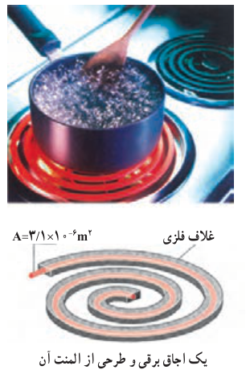

### مثال ۲ـ۳

شکل روبه‌رو، المنت یک اجاق برقی را نشان می‌دهد. این المنت شامل سیمی به طول $1.1\ \mathrm m$ و سطح مقطع $3.1\times10^{-6}\ \mathrm{m^2}$ است که داخل مادۀ عایقی قرار گرفته است که خود، درون یک غلاف فلزی است. با عبور جریان، المنت داغ می‌شود. مقاومت ویژۀ مادۀ سازندۀ سیم در دمای $T_0=320^\circ\mathrm C$ برابر با $\rho_0=6.8\times10^{-5}\ \Omega\cdot\mathrm m$ است. با افزایش دمای سیم مقاومت ویژۀ آن افزایش می‌یابد و در دمای $420^\circ\mathrm C$ به $8.2\times10^{-5}\ \Omega\cdot\mathrm m$ می‌رسد. مقاومت سیم در دماهای $320^\circ\mathrm C$ و $420^\circ\mathrm C$ چقدر است؟

**پاسخ:** با استفاده از رابطۀ ۲ـ۳ مقاومت سیم در دمای $320^\circ\mathrm C$ برابر است با:

$$R=\rho\frac LA=(6.8\times10^{-5}\ \Omega\cdot\mathrm m)\frac{1.1\ \mathrm m}{3.1\times10^{-6}\ \mathrm{m^2}}=24\ \Omega$$

و در دمای $420^\circ\mathrm C$ برابر است با:

$$R=\rho\frac LA=(8.2\times10^{-5}\ \Omega\cdot\mathrm m)\frac{1.1\ \mathrm m}{3.1\times10^{-6}\ \mathrm{m^2}}=29\ \Omega$$

### تمرین ۲ـ۲

سیم‌کشی خانه‌ها معمولاً با سیم‌های مسی‌ای صورت می‌گیرد که قطری برابر با $2.032\ \mathrm{mm}$ دارد. مقاومت $100\ \mathrm m$ از این سیم‌ها در دمای اتاق چقدر است؟

**رئوستا:** رئوستا² نوعی مقاومت متغیر است که از سیمی با مقاومت ویژۀ نسبتاً زیاد ساخته شده است. این سیم روی استوانه‌ای نارسانا پیچیده شده و با استفاده از دکمه‌ای لغزنده که روی ریلی در بالای استوانه قرار دارد و انتهای آن با سیم در تماس است می‌تواند قسمت دلخواهی از سیم را در مسیر جریان قرار دهد، و بنابراین مقدار مقاومت را تغییر دهد (شکل ۲ـ۱۲). در مدارهای الکترونیکی، وسیله‌ای به نام پتانسیومتر³ نقش رئوستا را دارد.

**جدول ۲ـ۲ مقاومت ویژه در دمای ۲۰°C برخی از رساناها و نیم‌رساناها**

| دسته | ماده | مقاومت ویژه $\rho$ (Ω.m) |
|---|---|---|
| رسانای فلزی | نقره | $1.6\times10^{-8}$ |
| رسانای فلزی | مس | $1.7\times10^{-8}$ |
| رسانای فلزی | طلا | $2.4\times10^{-8}$ |
| رسانای فلزی | آلومینیم | $2.8\times10^{-8}$ |
| رسانای فلزی | تنگستن | $5.5\times10^{-8}$ |
| رسانای فلزی | آهن | $9.7\times10^{-8}$ |
| رسانای فلزی | پلاتین | $10\times10^{-8}$ |
| رسانای فلزی | سرب | $22\times10^{-8}$ |
| رسانای فلزی | کنستانتان¹ | $44\times10^{-8}$ |
| رسانای فلزی | نیکروم² | $100\times10^{-8}$ |
| نیم‌رسانا | گرافیت | $3.5\times10^{-5}$ |
| نیم‌رسانا | ژرمانیم | ۰/۴۶ |
| نیم‌رسانا | سیلیسیم خالص | $2.5\times10^3$ |
| عایق | انواع شیشه | $10^{10}$–$10^{14}$ |
| عایق | لاستیک سخت | $10^{13}$ |
| عایق | کوارتز (ذوب شده) | $10^{16}$ |

۱ـ ۶۰ درصد مس، ۴۰ درصد نیکل

۲ـ ۵۹ درصد نیکل، ۲۳ درصد مس، ۱۶ درصد کروم و ...

۱ـ از افزایش طول و مساحت سیم بر اثر افزایش دما چشم‌پوشی می‌شود.

۲ـ Rheostat

۳ـ Potentiometer
