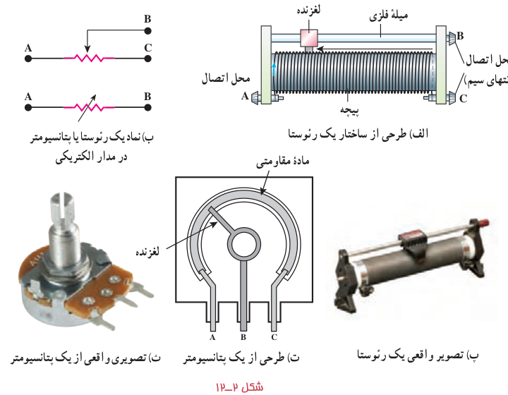
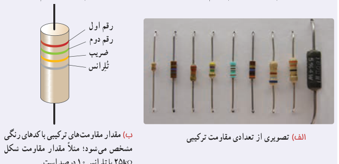

### خوب است بدانید: مقاومت‌های ترکیبی

مقاومت‌ها با فناوری‌های مختلفی ساخته می‌شوند. نوعی از مقاومت‌ها، مقاومت‌های ترکیبی¹ هستند. این مقاومت‌ها معمولاً از کربن، برخی نیم‌رساناها، و یا لایه‌های نازک فلزی ساخته شده‌اند. مقاومت‌های ترکیبی را در اندازه‌های خاص استانداردی تولید می‌کنند. مقدار این مقاومت‌ها یا روی آنها نوشته می‌شود، یا عمدتاً به‌صورت کدی رنگی نشان داده می‌شود که با ۳ یا ۴ حلقۀ رنگی روی آنها مشخص شده است (شکل الف). هر رنگ، معرف عددی است که در جدول داده شده است. دو حلقۀ اول (از آن طرفی که به یک سر مقاومت نزدیک‌تر است) به ترتیب، رقم اول و رقم دوم مقاومت را نشان می‌دهند. رقم حلقۀ سوم ضریبی

**جدول کد رنگی مقاومت‌ها**

| رنگ | عدد | ضریب | تلرانس |
|---|---|---|---|
| سیاه | ۰ | $10^0=1$ | |
| قهوه‌ای | ۱ | $10^1$ | |
| قرمز | ۲ | $10^2$ | |
| نارنجی | ۳ | $10^3$ | |
| زرد | ۴ | $10^4$ | |
| سبز | ۵ | $10^5$ | |
| آبی | ۶ | $10^6$ | |
| بنفش | ۷ | $10^7$ | |
| خاکستری | ۸ | $10^8$ | |
| سفید | ۹ | $10^9$ | |
| طلایی | | $10^{-1}$ | ۵٪ |
| نقره‌ای | | $10^{-2}$ | ۱۰٪ |
| بی‌رنگ | | | ۲۰٪ |

۱ـ composition resistors
