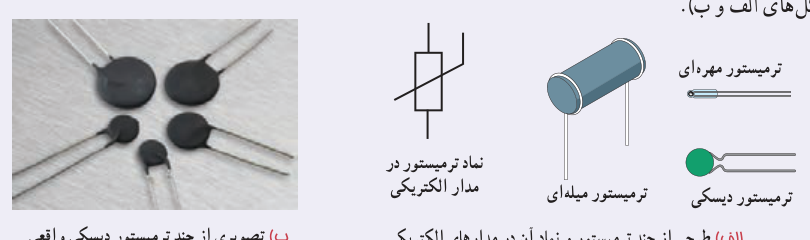
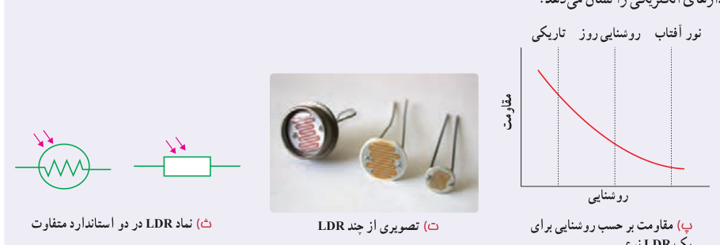

است به‌صورت $10^n$ که در ستون سوم جدول مشخص شده است. حلقۀ چهارم یک حلقۀ طلایی یا نقره‌ای رنگ است که تلرانس¹ نامیده می‌شود و مقدار مجاز انحراف از مقدار دقیق مقاومت را برحسب درصد مشخص می‌کند (شکل ب). نبود نوار چهارم به معنای آن است که تلرانس ۲۰ درصد است. برای خواندن حلقه‌های رنگی، مقاومت را طوری به دست می‌گیریم که حلقۀ تلرانس در سمت راست قرار گیرد و بقیۀ حلقه‌ها را از سمت چپ به راست می‌خوانیم.

### مقاومت‌های خاص و دیودها

**۱ـ ترمیستور²:** ترمیستور نوعی از مقاومت است که بستگی مقاومت الکتریکی آن به دما با مقاومت‌های الکتریکی معمولی تفاوت دارد. اغلب از ترمیستورها به‌عنوان حسگر دما در مدارهای حساس به دما مانند زنگ خطر آتش و دماپاها و نیز در دماسنج‌ها استفاده می‌شود. ترمیستورها در ابعاد کوچکی ساخته می‌شوند و شکل‌های متفاوتی دارند که رایج‌ترین آنها دیسکی، مهره‌ای، و میله‌ای است (شکل‌های الف و ب).

**۲ـ مقاومت‌های نوری³ (LDR)⁴:** مقاومت نوری، نوعی مقاومت است که مقاومت الکتریکی آن به نور تابیده شده به آن بستگی دارد، به طوری که با افزایش شدت نور، از مقاومت آن کاسته می‌شود. مثلاً یک LDR نوعی در تاریکی مقاومتی چند مگااهمی دارد، در حالی که در یک نور مناسب، مقاومت آن به چند صد اهم می‌رسد. نوعی از این مقاومت‌ها از جنس نیم‌رسانای خالص، مانند سیلیسیم هستند که با افزایش شدت نور تابیده‌شده از مقاومت آنها کاسته می‌شود. مثلاً شکل پ مقاومت الکتریکی چنین LDRهایی را برحسب روشنایی⁵ (که با یکای LUX سنجیده می‌شود) نشان می‌دهد. شکل ت تصویری از چند LDR و شکل ث دو نماد این مقاومت‌ها در مدارهای الکتریکی را نشان می‌دهد.

۱ـ Tolerance

۲ـ Thermistor، برگرفته از عبارت Thermal Sensetive Resistor به معنای مقاومت حساس به دما.

۳ـ Photoresistor

۴ـ Light Dependent Resistor

۵ـ Illumination
