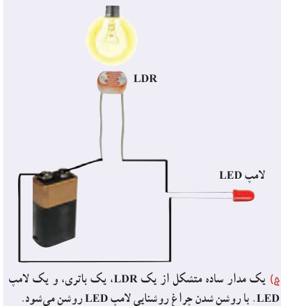
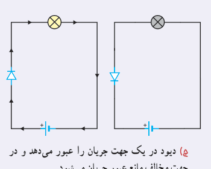
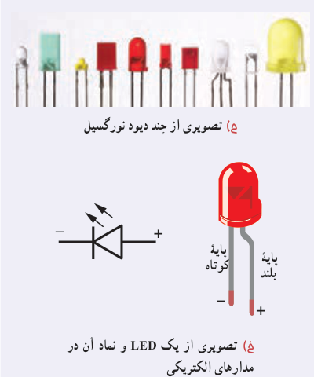

برای اینکه به درکی از ساز و کار این مقاومت‌ها برسید، شکل ج را در نظر بگیرید که در آن یک LDR در مداری ساده به یک لامپ LED متصل شده است. تا هنگامی که لامپ روشنایی شکل خاموش باشد، LDR مقاومت بالایی دارد و مانع از روشن شدن لامپ LED می‌شود. با روشن شدن لامپ روشنایی از مقاومت LDR کاسته می‌شود و لامپ LED روشن می‌گردد. با تنظیم لامپ روشنایی به ترتیبی که LDR در معرض نور بیشتری قرار گیرد، شدت نور لامپ LED بیشتر می‌شود.

از این ویژگی LDRها در تجهیزات گوناگونی از جمله چشم‌های الکترونیکی، دزدگیرها، کنترل‌کننده‌های خودکار، و چراغ‌های روشنایی خیابان‌ها استفاده می‌شود.

**۳ـ دیودها¹:** دیود قطعه‌ای است که هرگاه در مداری قرار گیرد، جریان را تنها از یک سو عبور می‌دهد و مقاومت آن در برابر عبور جریان در این سو ناچیز است. به‌همین دلیل، دیود را اغلب به عنوان یک‌سوکنندۀ جریان در نظر می‌گیرند و آن را با نماد دیود در مدارهای الکتریکی نشان می‌دهند. پیکان در این نماد جهتی را نشان می‌دهد که جریان می‌تواند از دیود عبور کند. مثلاً مدارهای سادۀ شکل چ نشان می‌دهد که با تعویض جهت دیود، جریان از مدار عبور نمی‌کند و لامپ خاموش می‌شود. همچنین از دیود در مدارهای یک‌سوکننده برای تبدیل جریان‌های متناوب به جریان‌های مستقیم استفاده می‌شود.

دیودها انواع متفاوتی دارند که یکی از معروف‌ترین آنها دیودهای نورگسیل یا LED² است (شکل ح). شکل خ تصویری واضح از یک LED و نماد آن در مدارهای الکتریکی را نشان می‌دهد. در این دیودها از نیم‌رساناهایی استفاده می‌شود که با عبور جریان از آنها LED از خود نور گسیل می‌کند و بنابراین، مقداری از انرژی الکتریکی به نور تبدیل می‌شود. بسته به نوع نیم‌رسانای به‌کاررفته، رنگ نور گسیل شده از LED می‌تواند از فروسرخ تا فرابنفش باشد.

۱ـ Diode

۲ـ Light Emitting Diode
