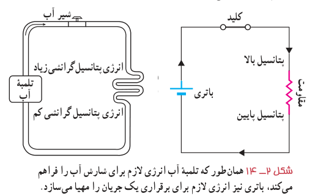
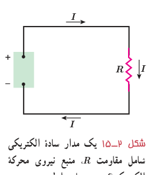

## ۲ـ۴ نیروی محرکۀ الکتریکی و مدارها

برای بالا بردن آب از سطح زمین به یک تلمبۀ آب نیاز است تا آب را به ارتفاع معینی برساند. بدین‌ترتیب، آب انرژی پتانسیل گرانشی لازم برای جریان یافتن و انجام کار معینی را کسب می‌کند (شکل ۲ـ۱۳). برای اینکه بارهای الکتریکی نیز در مدار جریان پیدا کنند و بتوانند از یک مقاومت الکتریکی عبور کنند، لازم است بین دو سر مقاومت اختلاف پتانسیلی برقرار کنیم تا انرژی لازم به بارهای الکتریکی داده شود. این کار می‌تواند توسط وسیله‌هایی مانند باتری انجام شود. به چنین وسیله‌هایی که با انجام کار روی بار الکتریکی، جریان ثابتی از بارهای الکتریکی در یک مدار ایجاد می‌کند، منبع نیروی محرکۀ الکتریکی گفته می‌شود. منبع‌های نیروی محرکۀ الکتریکی (مانند باتری‌ها) با افزایش انرژی پتانسیل بارهای الکتریکی هنگام عبور از منبع، جریان ثابتی را در مدار برقرار می‌کنند (شکل ۲ـ۱۴).

انرژی لازم برای ایجاد اختلاف پتانسیل الکتریکی در یک منبع نیروی محرکۀ الکتریکی با سازوکارهای مختلفی به دست می‌آید. مثلاً باتری‌ها که در علوم هشتم با آنها آشنا شدید این انرژی را از طریق واکنش‌های شیمیایی که در آنها رخ می‌دهد مهیا می‌سازند. پیل‌های سوختی، سلول‌های خورشیدی و مولدهای الکتریکی نمونه‌های دیگری از منبع‌های نیروی محرکۀ الکتریکی‌اند.

مدار سادۀ الکتریکی شکل ۲ـ۱۵ را در نظر بگیرید. منبع نیروی محرکه هنگام عبور بار $\Delta q$ از منبع کاری به اندازۀ $\Delta W$ روی آن انجام می‌دهد تا آن را در مدار به حرکت درآورد. کاری که منبع نیروی محرکۀ الکتریکی روی واحد بار الکتریکی مثبت انجام می‌دهد تا آن را از پایانه با پتانسیل کمتر به پایانه با پتانسیل بیشتر ببرد، اصطلاحاً نیروی محرکۀ الکتریکی¹ (emf) نامیده و با رابطۀ زیر تعریف می‌شود²:

$$\mathcal E=\frac{\Delta W}{\Delta q}\qquad (۲-۴)$$

یکای کمیت نیروی محرکۀ الکتریکی همان یکای اختلاف پتانسیل الکتریکی، یعنی ولت (V) است ($1\ \mathrm V=1\ \mathrm{J/C}$). پس اگر نیروی محرکۀ یک باتری مثلاً $1.5\ \mathrm V$ باشد، به این معناست که باتری روی هر کولن باری که از آن می‌گذرد $1.5\ \mathrm J$ کار انجام می‌دهد و به این ترتیب انرژی پتانسیل الکتریکی آن را $1.5\ \mathrm J$ افزایش می‌دهد (باتری بدون اتلاف انرژی).

۱ـ Electromotive Force

۲ـ توجه کنید که نیروی محرکۀ الکتریکی واژۀ نامناسبی است؛ زیرا emf نیرو نیست؛ بلکه مانند پتانسیل یک کمیت انرژی به ازای واحد بار است.
