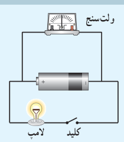
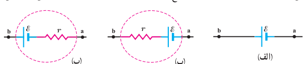
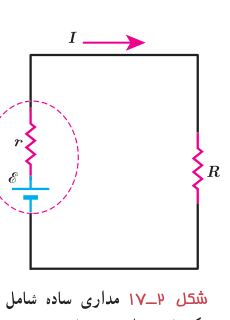

### فعالیت ۲ـ۲

به کمک یک باتری، سیم‌های رابط، لامپ کوچک، ولت‌سنج و کلید، مداری همانند شکل روبه‌رو درست کنید. قبل از بستن کلید عددی را که ولت‌سنج نشان می‌دهد بخوانید. سپس کلید را ببندید و دوباره عددی را که ولت‌سنج نشان می‌دهد بخوانید. در کدام حالت ولت‌سنج عدد بزرگ‌تری را نشان می‌دهد؟ چرا؟ در ادامه با علت تفاوت این دو عدد آشنا خواهید شد.

منبع‌های نیروی محرکۀ الکتریکی، یا آرمانی هستند و یا واقعی. اختلاف پتانسیل پایانه‌های مثبت و منفی یک منبع آرمانی برابر با نیروی محرکۀ الکتریکی $\mathcal E$ آن است:

$$\Delta V=\mathcal E\qquad (۲-۵)$$

معمولاً اختلاف پتانسیل پایانه‌های منبع نیروی محرکه (آرمانی یا واقعی) را به‌منظور ساده‌سازی به‌جای $\Delta V$ با $V$ نشان می‌دهند.

منبع آرمانی در واقعیت وجود ندارد و منبع‌های نیروی محرکۀ الکتریکی همواره دارای مقاومتی داخلی ($r$) هستند؛ یعنی درون آنها مقاومتی در برابر حرکت بارها وجود دارد. بنابراین، وقتی جریان از این منابع بگذرد، اختلاف پتانسیل بین پایانه‌های آنها برخلاف منابع آرمانی، متفاوت از نیروی محرکۀ الکتریکی خواهد شد. شکل ۲ـ۱۶ نماد منبع نیروی محرکه را در مدارهای الکتریکی نشان می‌دهد.

در یک مدار الکتریکی ساده که از یک منبع نیروی محرکۀ واقعی با نیروی محرکۀ $\mathcal E$ و مقاومت داخلی $r$ و یک مقاومت $R$ ساخته شده است (شکل ۲ـ۱۷) اختلاف پتانسیل پایانه‌های منبع از رابطۀ زیر به‌دست می‌آید:

$$V=\mathcal E-Ir\qquad (۲-۶)$$

که در آن $I$ جریان گذرنده از منبع است. در مدار شکل ۲ـ۱۷ دو سر باتری به دو سر مقاومت $R$ وصل شده است. بنابراین اختلاف پتانسیل دو سر باتری ($V=\mathcal E-Ir$) با اختلاف پتانسیل دو سر مقاومت ($V=IR$) برابر است. در نتیجه داریم:

$$\mathcal E-Ir=IR$$

و بنابراین:

$$I=\frac{\mathcal E}{R+r}\qquad (۲-۷)$$

