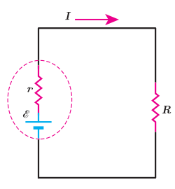
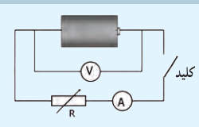
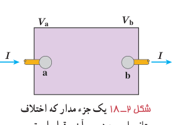

### مثال ۲ـ۴

در مدار شکل روبه‌رو فرض کنید $\mathcal E=12\ \mathrm V$، $r=2.0\ \Omega$ و $R=4.0\ \Omega$ باشد. الف) جریان عبوری از مدار چقدر است؟ ب) اختلاف پتانسیل دو سر باتری را محاسبه کنید.

**پاسخ:** الف) بنا به رابطۀ ۲ـ۷ داریم:

$$I=\frac{\mathcal E}{R+r}=\frac{12\ \mathrm V}{4.0\ \Omega+2.0\ \Omega}=2.0\ \mathrm A$$

ب) با استفاده از رابطۀ ۲ـ۶ اختلاف پتانسیل دو سر باتری برابر است با:

$$V=\mathcal E-Ir=12\ \mathrm V-(2.0\ \mathrm A)(2.0\ \Omega)=8\ \mathrm V$$

### فعالیت ۲ـ۳ (کار در کلاس)

تفاوت یک باتری نو و فرسوده عمدتاً در مقدار مقاومت داخلی آن است که می‌تواند کمتر از یک اهم برای باتری نو تا چند هزار اهم برای باتری فرسوده باشد. برای اندازه‌گیری مقاومت داخلی یک باتری مدار ساده‌ای متشکل از یک باتری، یک کلید قطع و وصل و یک مقاومت یا لامپ کوچک را سوار کنید. نخست درحالی‌که کلید قطع است، ولتاژ دو سر باتری را با یک ولت‌سنج اندازه بگیرید و آن‌گاه پس از بستن کلید، دوباره ولتاژ دو سر باتری را اندازه بگیرید. همچنین در این حالت، جریان عبوری از مدار را نیز باید به کمک یک آمپرسنج اندازه بگیرید. اکنون با استفاده از رابطۀ ۲ـ۶ مقاومت داخلی باتری را محاسبه کنید (البته در یک اندازه‌گیری دقیق‌تر معمولاً از یک مقاومت متغیر استفاده می‌شود و مقاومت داخلی پس از چندین اندازه‌گیری محاسبه می‌شود). آزمایش را یک بار برای باتری نو و یک بار برای باتری فرسوده انجام دهید.

## ۲ـ۵ توان در مدارهای الکتریکی

اکنون می‌خواهیم رابطه‌هایی برای انرژی و توان در مدارهای الکتریکی به‌دست آوریم. جعبۀ شکل ۲ـ۱۸ بخشی از یک مدار الکتریکی را نشان می‌دهد که می‌تواند شامل باتری، مقاومت و یا هر چیز دیگری باشد که اختلاف پتانسیلی بین پایانه‌های آن برقرار است. فرض کنید بار $q$ در مدت زمان $t$ تحت اختلاف پتانسیل $\Delta V$ از پایانۀ a به پایانۀ b برود. در فصل پیش دیدیم تغییر انرژی پتانسیل بار $q$ در این انتقال برابر با $\Delta U=q\Delta V$ است. از طرفی توان الکتریکی، آهنگ تغییر انرژی پتانسیل الکتریکی بار $q$ هنگام عبور از این بخش از مدار است:

$$P=\frac{\Delta U}{t}=\frac{q\Delta V}{t}=\left(\frac qt\right)\Delta V=I\Delta V$$

معمولاً اختلاف پتانسیل پایانه‌های a و b را به منظور ساده‌سازی به جای $\Delta V$ با $V$ نشان می‌دهند. بنابراین داریم:

$$P=IV\qquad (۲-۸)$$

