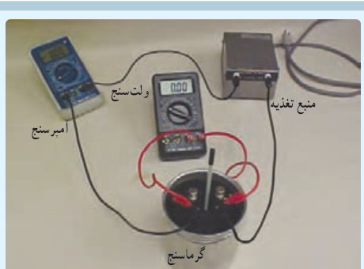

در این رابطه، توان ($P$) برحسب وات (W)، جریان ($I$) برحسب آمپر (A) و اختلاف پتانسیل ($V$) برحسب ولت (V) است. این رابطه را می‌توان برای منبع نیروی محرکه (مثلاً باتری)، یا برای وسیلۀ مصرف‌کننده (مثلاً مقاومت یک دستگاه الکتریکی) و یا ... استفاده کرد.

**توان الکتریکی مصرفی در یک مقاومت:** همان‌طور که گفتیم رابطۀ ۲ـ۸ برای مقاومت‌های الکتریکی نیز برقرار است. برای محاسبۀ توان مصرفی مقاومت، کافی است در این رابطه به‌جای $V$ از رابطۀ تعریف مقاومت ($R=V/I$) استفاده کنیم:

$$P_{\text{مصرفی}}=IV=I(RI)=RI^2=\frac{V^2}{R}$$

در نتیجه:

$$P_{\text{مصرفی}}=IV=RI^2=\frac{V^2}{R}\qquad (۲-۹)$$

### مثال ۲ـ۵

وقتی دو سر یک بخاری برقی را به اختلاف پتانسیل $220\ \mathrm V$ وصل کنیم، جریان $10.0\ \mathrm A$ از آن می‌گذرد. الف) توان این بخاری چقدر است؟ ب) اگر این بخاری به مدت $3.00\ \mathrm h$ در روز کار کند و قیمت برق مصرفی به ازای هر کیلووات‌ساعت ۵۰ تومان باشد، هزینۀ یک ماه مصرف این بخاری چقدر می‌شود؟

**پاسخ:** الف) بنا به رابطۀ ۲ـ۸ توان مورد نیاز بخاری چنین می‌شود:

$$P=IV=(10.0\ \mathrm A)(220\ \mathrm V)=2.20\times10^3\ \mathrm W=2.20\ \mathrm{kW}$$

ب) انرژی مصرفی بخاری برابر $Pt$ می‌شود که برحسب یکاهای SI، $P$ برحسب وات (W)، $t$ برحسب ثانیه (s) است و انرژی مصرفی برحسب ژول (J) می‌شود. اما برای محاسبۀ مصرف برق، $P$ را برحسب کیلووات (kW) و $t$ را برحسب ساعت (h) می‌گیرند. بنابراین، انرژی الکتریکی مصرفی برحسب کیلووات‌ساعت (kWh) می‌شود ($1\ \mathrm{kWh}=(1000\ \mathrm{J/s})(3600\ \mathrm s)=3.6\times10^6\ \mathrm J$). پس انرژی مصرفی بخاری در یک ماه، برابر است با:

$$U=Pt=(2.20\ \mathrm{kW})(30\times3.00\ \mathrm h)=198\ \mathrm{kWh}$$

در نتیجه بهای برق مصرفی این بخاری در یک ماه چنین می‌شود:

$$\text{بها}=(198\ \mathrm{kWh})(50\ \text{تومان/kWh})=9900\ \text{تومان}$$

### فعالیت ۲ـ۴

قانون ژول بیان می‌دارد گرمای تولید شده توسط جریان $I$ی عبوری از یک مقاومت $R$ در مدت زمان $t$ برابر با $RI^2t$ است. این قانون را می‌توان به روش گرماسنجی با یک گرماسنج که در فیزیک دهم با آن آشنا شدید تحقیق کرد. اسباب این آزمایش در شکل نشان داده شده است. دربارۀ چگونگی این آزمایش توضیح دهید.

