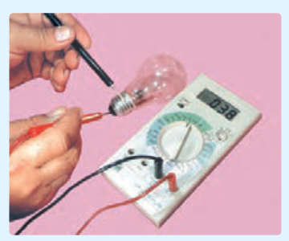
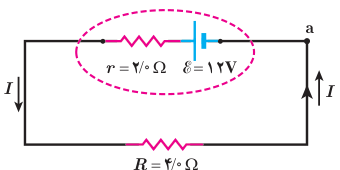

### فعالیت ۲ـ۵

همانند شکل با یک اهم‌متر، مقاومت رشتۀ سیم داخل لامپ ۱۰۰ واتی را اندازه‌گیری کنید. سپس با استفاده از رابطۀ $P_{\text{مصرفی}}=V^2/R$، و با داشتن مشخصات روی لامپ، مقاومت آن را در حالت روشن محاسبه کنید. چرا مقدار اندازه‌گیری شده با مقدار محاسبه‌شده متفاوت است؟ نتیجه را پس از گفت‌وگوی گروهی، گزارش دهید.

### مثال ۲ـ۶

برای مدار نشان داده شده در شکل، الف) توان مصرفی در مقاومت و ب) توان خروجی باتری را محاسبه کنید.

**پاسخ:** الف) نخست، جریان را با استفاده از رابطۀ ۲ـ۷ به دست می‌آوریم:

$$I=\frac{\mathcal E}{R+r}=\frac{12.0\ \mathrm V}{4.0\ \Omega+2.0\ \Omega}=2.0\ \mathrm A$$

اکنون توان مصرفی مقاومت $R$ چنین می‌شود:

$$P_{\text{مصرفی}}=RI^2=(4.0\ \Omega)(2.0\ \mathrm A)^2=16\ \mathrm W$$

ب) با استفاده از پایستگی انرژی بدیهی است که توان الکتریکی خروجی باتری برابر با توان مصرفی مقاومت ۴ اهمی، یعنی ۱۶ W می‌شود. با این حال، این را می‌توانیم به‌طور مستقیم نیز نشان دهیم:

$$V_{\text{باتری}}=\mathcal E-Ir=12.0\ \mathrm V-(2.0\ \mathrm A)(2.0\ \Omega)=8.0\ \mathrm V$$

$$P_{\text{خروجی باتری}}=IV_{\text{باتری}}=(2.0\ \mathrm A)(8.0\ \mathrm V)=16\ \mathrm W$$

## ۲ـ۶ ترکیب مقاومت‌ها

مقاومت‌ها در انواع وسایل الکتریکی دیده می‌شوند، از ساده‌ترین وسیله‌ها مانند بخاری‌های برقی و موخشک‌کن‌ها گرفته تا وسایل الکتریکی پیچیده‌تری مانند تلویزیون و رایانه‌ها. مدارهای این وسیله‌ها اغلب چندین مقاومت دارند؛ در نتیجه لازم است که ترکیبی از مقاومت‌ها را در نظر بگیریم. رشته‌ای از لامپ‌ها که در چراغانی‌ها به‌کار می‌رود، نمونۀ ساده‌ای از ترکیب مقاومت‌هاست که در آن هر لامپ به‌عنوان یک مقاومت عمل می‌کند و رشتۀ لامپ‌ها از دیدگاه تحلیل مدار، ترکیبی است از مقاومت‌ها. ترکیب مقاومت‌ها ممکن است بسیار پیچیده باشد، اما کار کردن با دو نوع از این ترکیب‌ها بسیار ساده است: مقاومت‌های متوالی و مقاومت‌های موازی. وقتی مقاومت‌ها به‌طور متوالی، یا موازی یا ترکیبی از هر دو بسته شده باشند، آنها را می‌توانیم با یک مقاومت معادل
