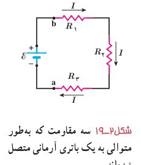
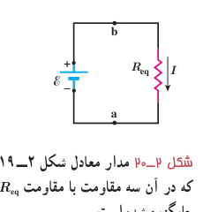
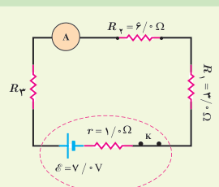

جایگزین کنیم. در این بخش به این موضوع می‌پردازیم و اینکه چگونه می‌توان مقاومت معادل ترکیبی از مقاومت‌ها را تعیین کرد.

**به هم بستن متوالی مقاومت‌ها:** شکل ۲ـ۱۹ سه مقاومت را نشان می‌دهد که به‌طور متوالی به یک باتری آرمانی با نیروی محرکۀ الکتریکی $\mathcal E$ بسته شده‌اند. توجه کنید واژۀ «متوالی» ربط چندانی به چگونگی رسم مقاومت‌ها ندارد. «متوالی» به معنای بسته شدن مقاومت‌ها یکی پس از دیگری است، به‌طوری که هیچ انشعابی بین آنها وجود نداشته باشد و اختلاف پتانسیل $V$ به دو سر این مجموعه از مقاومت‌ها اعمال شده باشد. در بستن متوالی مقاومت‌ها از همۀ مقاومت‌ها جریان یکسان $I$ عبور می‌کند. به عبارتی اگر آمپرسنج‌هایی را در نقطه‌های مختلفی از این مدار قرار دهیم، همگی جریان یکسانی را نشان می‌دهند. مقاومت‌هایی را که به‌طور متوالی بسته شده‌اند می‌توان با یک مقاومت معادل $R_{eq}$ جایگزین کرد که دارای همان اختلاف پتانسیل کل اعمال‌شده به دو سر مجموعۀ مقاومت‌ها و همان جریان $I$ است.

اختلاف پتانسیل کل اعمال شده به دو سر مجموعۀ مقاومت‌ها، برابر با جمع اختلاف پتانسیل‌های دو سر مقاومت‌هاست: $V=\mathcal E=V_1+V_2+V_3$. اکنون به سراغ محاسبۀ جریان $I$ می‌رویم. با به‌کارگیری تعریف مقاومت الکتریکی ($R=V/I$) برای هر یک از مقاومت‌ها و با توجه به برابر بودن جریان آنها داریم:

$$V=\mathcal E=IR_1+IR_2+IR_3$$

و در نتیجه:

$$I=\frac{\mathcal E}{R_1+R_2+R_3}$$

با تعریف مقاومت معادل، به‌صورت:

$$R_{eq}=R_1+R_2+R_3$$

مدار شکل ۲ـ۱۹ را می‌توان با مدار معادل شکل ۲ـ۲۰ جایگزین کرد. بدیهی است که اگر به‌جای سه مقاومت، $n$ مقاومت متوالی داشته باشیم، مقاومت معادل آنها از رابطۀ زیر به‌دست می‌آید:

$$R_{eq}=R_1+R_2+R_3+\cdots+R_n\qquad (۲-۱۰)$$

توجه کنید وقتی مقاومت‌ها به‌طور متوالی بسته شده‌اند، مقاومت معادل آنها بزرگ‌تر از مقاومت هریک از آنهاست.

### تمرین ۲ـ۳

در شکل روبه‌رو، سه مقاومت به همراه یک آمپرسنج به‌صورت متوالی به یک باتری وصل شده‌اند و مقاومت آمپرسنج صفر است (آمپرسنج آرمانی). اگر مقاومت معادل مقاومت‌های $R_1$، $R_2$ و $R_3$ برابر با $13.0\ \Omega$ باشد: الف) مقاومت $R_3$ چقدر است؟ ب) جریانی را که آمپرسنج نشان می‌دهد به‌دست آورید. پ) توان خروجی باتری چقدر است؟

