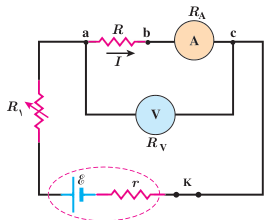
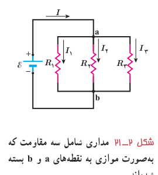

### مثال ۲ـ۷

شکل روبه‌رو مداری را برای اندازه‌گیری مقاومت مجهول $R$ نشان می‌دهد. فرض کنید در این مدار ولت‌سنج $24.0\ \mathrm V$ و آمپرسنج $0.200\ \mathrm A$ را نشان دهد. مقاومت ولت‌سنج $R_V=1.00\times10^4\ \Omega$ و مقاومت آمپرسنج $R_A=1.00\ \Omega$ است. مقاومت $R$ را به‌دست آورید.

**پاسخ:** مقاومت‌های $R$ و $R_A$ به‌طور متوالی به هم بسته شده‌اند و اختلاف پتانسیل دو سر آنها برابر با $24.0\ \mathrm V$ است. با توجه به اینکه آمپرسنج جریان $0.200\ \mathrm A$ را نشان می‌دهد و به‌طور متوالی به مقاومت $R$ بسته شده است، جریان عبوری از این دو مقاومت نیز برابر $0.200\ \mathrm A$ است:

$$R_{eq}=\frac VI=\frac{24.0\ \mathrm V}{0.200\ \mathrm A}=120\ \Omega$$

با توجه به اینکه $R_{eq}=R+R_A$ و $R_A=1.00\ \Omega$ است مقاومت مجهول برابر با $R=119\ \Omega$ می‌شود.

مقاومت یک ولت‌سنج باید خیلی بزرگ باشد تا قرار گرفتن آن در مدار، ولتاژ اجزای مدار را به‌طور محسوسی تغییر ندهد. همچنین مقاومت یک آمپرسنج باید خیلی ناچیز باشد تا قرار گرفتن آن در مدار به‌طور محسوسی جریان اجزای مدار را تغییر ندهد. همان‌طور که در مثال بالا ملاحظه شد، مقاومت‌های آمپرسنج و ولت‌سنج این ویژگی‌ها را دارند.

**بستن مقاومت‌ها به‌صورت موازی:** شکل ۲ـ۲۱ یک مدار الکتریکی را نشان می‌دهد که سه مقاومت به‌صورت موازی به یک باتری آرمانی با نیروی محرکۀ الکتریکی $\mathcal E$ بسته شده‌اند. توجه کنید واژۀ «موازی» ارتباط چندانی به چگونگی رسم مقاومت‌ها ندارد؛ بلکه «به‌صورت موازی» به معنای آن است که یک سر مقاومت‌ها مستقیماً به یکدیگر و سر دیگر آنها نیز مستقیماً به هم وصل شده است و اختلاف پتانسیل یکسان $V$ به دو سر این مقاومت‌ها اعمال شده است. بنابراین، هریک از مقاومت‌ها اختلاف پتانسیل یکسان $V$ در دو سر خود دارد؛ یعنی:

$$V=\mathcal E=V_1=V_2=V_3$$

مجموعۀ مقاومت‌هایی را که به این روش متصل شده‌اند می‌توان با یک مقاومت معادل $R_{eq}$ جایگزین کرد که دارای همان اختلاف پتانسیل $V$ و جریان کلی است که از مقاومت‌ها می‌گذرد. برای یافتن عبارتی برای $R_{eq}$، نخست رابطۀ بین جریان‌های $I$، $I_1$، $I_2$ و $I_3$ را بررسی می‌کنیم. با توجه به پایستگی بار الکتریکی و اینکه هیچ باری نمی‌تواند در یک نقطۀ مدار جمع گردد، بار ورودی به نقطۀ a در واحد زمان با مجموع بارهای خروجی از نقطۀ a در واحد زمان برابر است. همان‌طور که می‌دانیم بار عبوری در واحد زمان همان جریان است. بنابراین داریم:

$$I=I_1+I_2+I_3$$

از طرفی، از تعریف مقاومت می‌توانیم جریان‌های عبوری از هریک از مقاومت‌ها را به‌دست آوریم:

$$I_1=\frac V{R_1},\quad I_2=\frac V{R_2},\quad I_3=\frac V{R_3}$$

با قرار دادن این جریان‌ها در معادلۀ قبلی خواهیم داشت:

$$I=V\left(\frac1{R_1}+\frac1{R_2}+\frac1{R_3}\right)$$
