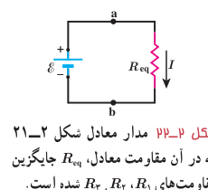
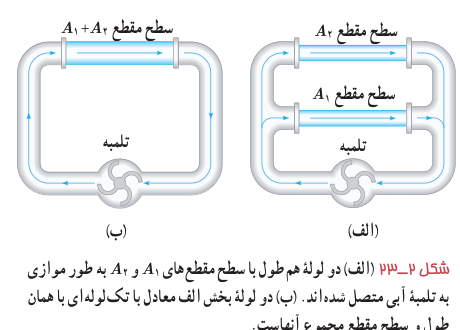
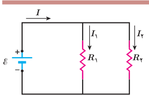

اگر ترکیب موازی مقاومت‌ها را با مقاومت $R_{eq}$ جایگزین کنیم $I=V/R_{eq}$ می‌شود و از آنجا خواهیم داشت:

$$\frac1{R_{eq}}=\frac1{R_1}+\frac1{R_2}+\frac1{R_3}$$

در حالت کلی برای $n$ مقاومت موازی به رابطۀ زیر می‌رسیم:

$$\frac1{R_{eq}}=\frac1{R_1}+\frac1{R_2}+\frac1{R_3}+\cdots+\frac1{R_n}\qquad (۲-۱۱)$$

مدار شکل ۲ـ۲۱ به مدار معادل شکل ۲ـ۲۲ تبدیل می‌شود. توجه کنید هرگاه چند مقاومت به‌صورت موازی به هم بسته شوند، مقاومت معادل آنها کوچک‌تر از هریک از مقاومت‌های موجود در آن ترکیب است. برای اینکه به درکی از این نتیجه برسیم، مشابهت‌سازی با لوله‌های آب می‌تواند راه‌گشا باشد. شکل ۲ـ۲۳ الف دو لولۀ هم‌طول با سطح مقطع‌های $A_1$ و $A_2$ را نشان می‌دهد که به‌طور موازی به یک تلمبۀ آب متصل شده‌اند. در شکل ۲ـ۲۳ ب این دو لوله با یک تک لوله به همان طول آنها، ولی با سطح مقطعی برابر با مجموع سطح مقطع‌های آن دو لوله جایگزین شده است. اکنون تلمبه، آب بیشتری از لولۀ عریض‌تر در مقایسه با هریک از لوله‌ها عبور می‌دهد. به عبارتی، لولۀ عریض‌تر مقاومت کمتری نسبت به شارش آب در مقایسه با هریک از دو لولۀ باریک‌تر دارد.

### مثال ۲ـ۸

در شکل روبه‌رو، یک باتری آرمانی اختلاف پتانسیل $\mathcal E=12\ \mathrm V$ را به دو سر مقاومت‌های $R_1=4.0\ \Omega$ و $R_2=6.0\ \Omega$ اعمال می‌کند. الف) جریان عبوری از هر مقاومت و ب) جریانی که از باتری می‌گذرد چقدر است؟

**پاسخ:** مطابق شکل جریان عبوری از باتری، مقاومت $R_1$، و مقاومت $R_2$ را به ترتیب با $I$، $I_1$ و $I_2$ نشان داده‌ایم.

الف) بدیهی است که اختلاف پتانسیل دو سر مقاومت‌های $R_1$ و $R_2$ برابر با اختلاف پتانسیل باتری است. بنابراین داریم:

$$V_1=\mathcal E=I_1R_1\Rightarrow I_1=\frac{\mathcal E}{R_1}=\frac{12\ \mathrm V}{4.0\ \Omega}=3.0\ \mathrm A$$

$$V_2=\mathcal E=I_2R_2\Rightarrow I_2=\frac{\mathcal E}{R_2}=\frac{12\ \mathrm V}{6.0\ \Omega}=2.0\ \mathrm A$$

ب) برای جریان عبوری از باتری داریم:

$$I=I_1+I_2=3.0\ \mathrm A+2.0\ \mathrm A=5.0\ \mathrm A$$

### فعالیت ۲ـ۶

مداری مانند مدار مثال ۲ـ۸ ببندید و در هر شاخۀ آن، یک آمپرسنج قرار دهید. با خواندن آمپرسنج‌ها، رابطۀ بین جریان‌ها را بررسی کنید.
