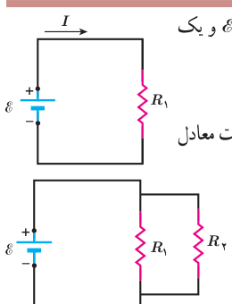
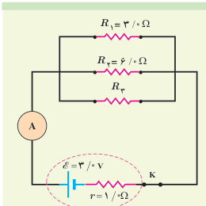

### مثال ۲ـ۹

مدار سادۀ شکل روبه‌رو را که شامل یک منبع نیروی محرکۀ الکتریکی آرمانی با $\mathcal E=150\ \mathrm V$ و یک مقاومت با $R_1=100\ \mathrm{k\Omega}$ است، در نظر بگیرید. الف) جریان عبوری از منبع را به‌دست آورید. ب) اگر مقاومت $R_2=10.0\ \mathrm{M\Omega}$ به‌طور موازی به دو سر مقاومت $R_1$ متصل شود، مقاومت معادل مدار چقدر می‌شود و چه جریانی از منبع می‌گذرد؟

**پاسخ:** الف) با استفاده از تعریف مقاومت داریم:

$$I=\frac{\mathcal E}{R_1}=\frac{150\ \mathrm V}{100\times10^3\ \Omega}=1.50\times10^{-3}\ \mathrm A=1.50\ \mathrm{mA}$$

ب) با استفاده از رابطۀ ۲ـ۱۱ داریم:

$$\frac1{R_{eq}}=\frac1{R_1}+\frac1{R_2}$$

در نتیجه:

$$R_{eq}=\frac{R_1R_2}{R_1+R_2}=\frac{(100\times10^3\ \Omega)(10.0\times10^6\ \Omega)}{100\times10^3\ \Omega+10.0\times10^6\ \Omega}=99.0\ \mathrm{k\Omega}$$

و بنابراین، جریان عبوری از منبع برابر است با:

$$I=\frac{\mathcal E}{R_{eq}}=\frac{150\ \mathrm V}{9.90\times10^4\ \Omega}=1.52\times10^{-3}\ \mathrm A=1.52\ \mathrm{mA}$$

همان‌طور که می‌بینید، مقاومت معادل در این حالت که یکی از مقاومت‌ها خیلی بزرگ‌تر از مقاومت دیگر است ($R_2\gg R_1$) تقریباً برابر با مقاومت کوچک‌تر ($R_1$) است.

### تمرین ۲ـ۴

در شکل روبه‌رو سه مقاومت موازی به همراه یک آمپرسنج آرمانی به دو سر یک باتری وصل شده‌اند. اگر مقاومت معادل این ترکیب $1.6\ \Omega$ باشد، الف) مقاومت $R_3$ چقدر است؟ ب) جریانی که آمپرسنج نشان می‌دهد را به‌دست آورید. پ) توان خروجی باتری چقدر است؟

### مثال ۲ـ۱۰

یک لامپ رشته‌ای ۱۰۰ W، یک بخاری برقی ۲۰۰۰ W، یک دستگاه پخش صوت ۲۰۰ W، و یک سشوار (موخشک‌کن) ۲۲۰۰ W مطابق شکل به پریزهای یک مدار سیم‌کشی خانگی ۲۲۰ V وصل شده است.

الف) فیوز قطعه‌ای حفاظتی در مسیر سیم‌کشی‌های الکتریکی است که وقتی جریان الکتریکی بخواهد از حد مجاز بیشتر شود، جریان را قطع می‌کند. اگر فیوز شکل، ۱۵ A باشد، یعنی حداکثر بتواند جریان ۱۵ A را تحمل کند، آیا فیوز خواهد پرید؟

ب) نشان دهید توان الکتریکی مصرفی مقاومت معادل برابر با مجموع توان‌های الکتریکی مصرفی در هر یک از آنهاست.
