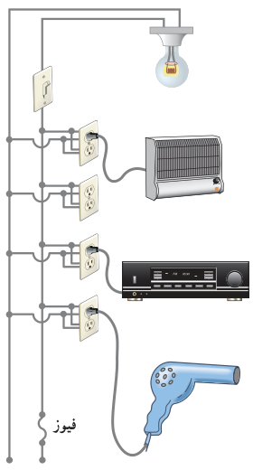

**پاسخ:** الف) همان‌طور که در شکل می‌بینیم در سیم‌کشی منازل همۀ مصرف‌کننده‌ها به‌طور موازی متصل می‌شوند. بنابراین، جریان کل عبوری از فیوز برابر با مجموع جریان‌های عبوری از هریک از مصرف‌کننده‌هاست. با استفاده از رابطۀ $I=P/V$ جریان عبوری از هریک از این چهار مصرف‌کننده را به‌دست می‌آوریم. بنابراین، به ترتیب داریم:

$$I_{\text{لامپ}}=\frac{100\ \mathrm W}{220\ \mathrm V}=0.455\ \mathrm A$$

$$I_{\text{بخاری}}=\frac{2000\ \mathrm W}{220\ \mathrm V}=9.09\ \mathrm A$$

$$I_{\text{پخش}}=\frac{200\ \mathrm W}{220\ \mathrm V}=0.909\ \mathrm A$$

$$I_{\text{سشوار}}=\frac{2200\ \mathrm W}{220\ \mathrm V}=10.0\ \mathrm A$$

بنابراین، جریان کل عبوری از فیوز برابر است با:

$$I_{\text{فیوز}}=I_{\text{کل}}=I_{\text{لامپ}}+I_{\text{بخاری}}+I_{\text{پخش}}+I_{\text{سشوار}}=0.455+9.09+0.909+10.0=20.5\ \mathrm A$$

چون فیوز ۱۵ A است، بنابراین، فیوز نشان داده شده در شکل، خواهد پرید. در اغلب منازل چند مدار سیم‌کشی جداگانه داریم که هریک فیوز مربوط به خود را دارد. برای اینکه بتوانیم به‌طور هم‌زمان از چند وسیلۀ برقی استفاده کنیم، باید وسایل برقی را به‌طور هم‌زمان به یک مدار وصل نکنیم و مدارهای دیگر را نیز به‌کار گیریم.

ب) دیدیم که همۀ مصرف‌کننده‌ها به‌طور موازی متصل می‌شوند. بنابراین، مقاومت معادل مصرف‌کننده‌های شکل از رابطۀ ۲ـ۱۱ به‌دست می‌آید. بنابراین، برای محاسبۀ مقاومت لازم است مقاومت هریک از وسیله‌ها را به‌طور جداگانه محاسبه کنیم. مقاومت هر مصرف‌کننده با استفاده از رابطۀ $P=V^2/R$ به‌دست می‌آید. بنابراین، به ترتیب داریم:

$$R_{\text{لامپ}}=\frac{(220\ \mathrm V)^2}{100\ \mathrm W}=484\ \Omega,\quad R_{\text{بخاری}}=\frac{(220\ \mathrm V)^2}{2000\ \mathrm W}=24.2\ \Omega$$

$$R_{\text{پخش}}=\frac{(220\ \mathrm V)^2}{200\ \mathrm W}=242\ \Omega,\quad R_{\text{سشوار}}=\frac{(220\ \mathrm V)^2}{2200\ \mathrm W}=22.0\ \Omega$$

پس مقاومت معادل چنین محاسبه می‌شود:

$$\frac1{R_{eq}}=\frac1{484\ \Omega}+\frac1{24.2\ \Omega}+\frac1{242\ \Omega}+\frac1{22.0\ \Omega}=0.0930\ \Omega^{-1}$$

و در نتیجه $R_{eq}=10.75\ \Omega\approx10.8\ \Omega$. بنابراین، توان مصرفی مقاومت معادل چنین می‌شود:

$$P_{R_{eq}}=\frac{V^2}{R_{eq}}=\frac{(220\ \mathrm V)^2}{10.75\ \Omega}=4.50\ \mathrm{kW}$$
