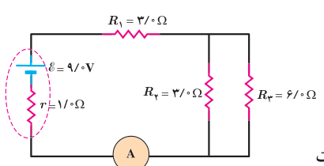
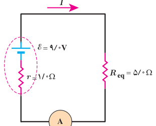

اکنون می‌خواهیم این نتیجه را با مجموع توان‌های هریک از مصرف‌کننده‌ها مقایسه کنیم. مجموع توان مصرف‌کننده‌ها برابر است با:

$$P_{\text{کل}}=P_{\text{لامپ}}+P_{\text{بخاری}}+P_{\text{پخش}}+P_{\text{سشوار}}=100\ \mathrm W+2000\ \mathrm W+200\ \mathrm W+2200\ \mathrm W=4500\ \mathrm W$$

که همان توان مصرفی مقاومت معادل است.

### مثال ۲ـ۱۱

در مدار شکل روبه‌رو الف) مقاومت معادل، ب) جریانی که آمپرسنج نشان می‌دهد، و پ) جریان گذرنده از مقاومت‌های $R_1$ و $R_2$ را محاسبه کنید.

**پاسخ:** الف) مقاومت‌های $R_2$ و $R_3$ موازی با هم وصل شده‌اند، مقاومت معادل آنها را $R_{23}$ می‌نامیم.

$$\frac1{R_{23}}=\frac1{R_2}+\frac1{R_3}\Rightarrow R_{23}=\frac{R_2R_3}{R_2+R_3}=\frac{(3.0\ \Omega)(6.0\ \Omega)}{3.0\ \Omega+6.0\ \Omega}=2.0\ \Omega$$

مقاومت معادل $R_{23}$ و مقاومت $R_1$ متوالی با هم وصل شده‌اند. مقاومت معادل آنها را با $R_{eq}$ نشان می‌دهیم:

$$R_{eq}=R_1+R_{23}=3.0\ \Omega+2.0\ \Omega=5.0\ \Omega$$

ب) با استفاده از رابطۀ ۲ـ۷ برای شکل روبه‌رو داریم:

$$I=\frac{\mathcal E}{R_{eq}+r}=\frac{9.0\ \mathrm V}{5.0\ \Omega+1.0\ \Omega}=1.5\ \mathrm A$$

جریان گذرنده از باتری، مقاومت معادل $R_{eq}$ و آمپرسنج یکسان است. بنابراین آمپرسنج جریان $1.5\ \mathrm A$ را نشان می‌دهد.

پ) می‌دانیم جریان گذرنده از مقاومت‌های متوالی با جریان مقاومت معادل آنها برابر است. پس،

$$I_1=I_{23}=I\Rightarrow I_1=I_{23}=1.5\ \mathrm A$$

برای به‌دست آوردن $I_2$، نخست $V_2$ را به دست می‌آوریم. می‌دانیم در مقاومت‌های موازی، ولتاژ هر مقاومت با ولتاژ مقاومت معادل برابر است. پس $V_2=V_{23}$، و بنابراین کافی است $V_{23}$ را بیابیم:

$$V_{23}=R_{23}I_{23}=(2.0\ \Omega)(1.5\ \mathrm A)=3.0\ \mathrm V$$

در نتیجه برای جریان $I_2$ داریم:

$$I_2=\frac{V_2}{R_2}=\frac{V_{23}}{R_2}=\frac{3.0\ \mathrm V}{3.0\ \Omega}=1.0\ \mathrm A$$
