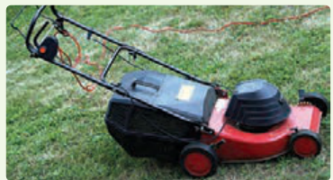
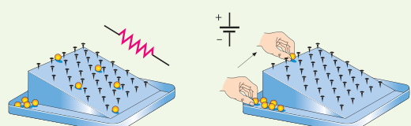
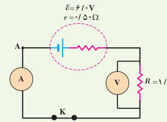
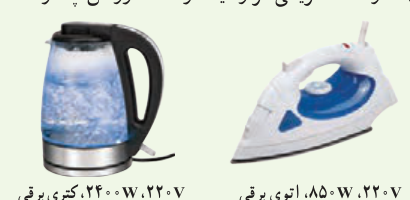
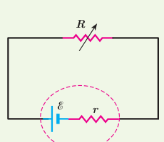

سیم ۳۰ متری ماشین چمن‌زنی چقدر است؟ ب) مقاومت یک سیم ۷۰ متری ماشین چمن‌زنی چقدر است؟ (دمای سیم‌ها را ۲۰°C درنظر بگیرید.)

### ۲ـ۴ نیروی محرکۀ الکتریکی و مدارها

۹. شکل زیر یک مشابهت‌سازی مکانیکی برای درک مقاومت و نیروی محرکۀ الکتریکی را نشان می‌دهد که در آن بر سطح شیب‌داری میخ‌هایی تعبیه شده و تیله‌ها از ارتفاع بالای سطح شیب‌دار رها می‌شوند و سپس دوباره به بالای سطح شیب‌دار بازگردانده می‌شوند. این مشابهت‌سازی مکانیکی را توجیه کنید.

۱۰. یک باتری را در نظر بگیرید که وقتی به مدار بسته نیست پتانسیل دو سرش برابر $12.0\ \mathrm V$ است. وقتی یک مقاومت $10.0\ \Omega$ به این باتری بسته شود، اختلاف پتانسیل دو سر باتری به $10.9\ \mathrm V$ کاهش می‌یابد. مقاومت داخلی باتری چقدر است؟

۱۱. در شکل زیر آمپرسنج و ولت‌سنج چه عددهایی را نشان می‌دهند؟

### ۲ـ۵ توان در مدارهای الکتریکی

۱۲. دو لامپ رشته‌ای در اختیار داریم که جنس و طول رشتۀ آنها یکسان است، ولی رشتۀ لامپ B ضخیم‌تر از رشتۀ لامپ A است. وقتی لامپ‌ها به ولتاژ یکسانی وصل شوند، کدام لامپ پرنورتر خواهد بود و چرا؟

۱۳. بر روی وسیله‌های الکتریکی، اعداد مربوط به ولتاژ و توان نوشته می‌شود. برای دو وسیلۀ زیر، الف) سیم‌های اتصال به برق آنها باید بتوانند حداقل چه جریانی را از خود عبور دهند؟ ب) مقاومت الکتریکی هر وسیله در حالت روشن چقدر است؟

۱۴. تلویزیون و یکی از لامپ‌های خانۀ خود را در نظر بگیرید و فرض کنید که هرکدام روزی ۸ ساعت با اختلاف پتانسیل ۲۲۰ ولت روشن باشد. الف) انرژی الکتریکی مصرفی هرکدام در دورۀ یک ماهه (۳۰ روز) چند kWh است؟ (توان مصرفی هر وسیله را از روی آن بخوانید.) ب) بهای برق مصرفی هر کدام از قرار هر کیلووات‌ساعت ۵۰ تومان در یک دورۀ یک ماهه چقدر می‌شود؟ پ) اگر در شهر شما هر خانه یک لامپ ۱۰۰ وات اضافی را به مدت ۳ ساعت در شب روشن کند، در طول یک ماه تقریباً چند کیلووات‌ساعت انرژی الکتریکی اضافی مصرف می‌شود؟

۱۵. در شکل زیر، الف) نیروی محرکۀ الکتریکی و مقاومت

