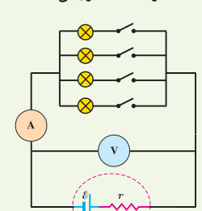
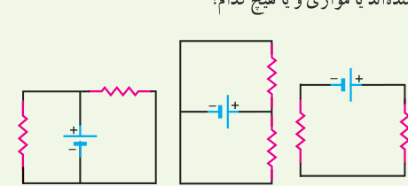
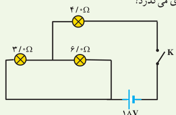
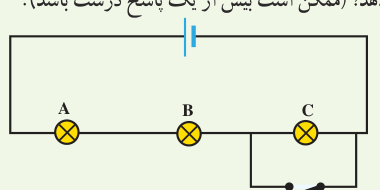

داخلی منبع را که توان خروجی آن به ازای $I_1=5.00\ \mathrm A$ برابر $9.50\ \mathrm W$ و به ازای $I_2=7.00\ \mathrm A$ برابر $12.6\ \mathrm W$ است، محاسبه کنید. ب) نمودار اختلاف پتانسیل دو سر باتری برحسب جریان گذرنده از آن را رسم کنید.

### ۲ـ۶ ترکیب مقاومت‌ها

۱۶. به نظر شما چرا چراغ‌های خودرو (چراغ‌های جلو، عقب و ...)، به‌طور موازی بسته می‌شوند؟

۱۷. مقاومت یک آمپرسنج برای اندازه‌گیری جریان در یک مدار باید چگونه باشد تا جریان اندازه‌گیری‌شده توسط آمپرسنج با جریان قبل از قرار دادن آمپرسنج، نزدیک به هم باشد؟

۱۸. در شکل زیر، تعدادی لامپ مشابه به‌طور موازی به هم متصل شده‌اند و هر لامپ با کلیدی همراه است. بررسی کنید که با بستن کلیدها یکی پس از دیگری، عددهایی که آمپرسنج و ولت‌سنج نشان می‌دهند، چه تغییری می‌کند؟

۱۹. دو لامپ با مقاومت مساوی $R$ را یک بار به‌طور متوالی و بار دیگر به‌طور موازی به یکدیگر می‌بندیم و آنها را هر بار به ولتاژ $V$ وصل می‌کنیم. نسبت توان مصرف‌شده در حالت موازی به توان مصرف‌شده در حالت متوالی چقدر است؟

۲۰. در شکل‌های زیر، آیا مقاومت‌ها به‌طور متوالی بسته شده‌اند یا موازی و یا هیچ‌کدام؟

۲۱. سه مقاومت مشابه ۱۲ اهمی را یک بار به‌طور متوالی و بار دیگر به‌طور موازی به یکدیگر می‌بندیم و به اختلاف پتانسیل ۱۲ ولت وصل می‌کنیم. در هر بار، چه جریانی از هر مقاومت می‌گذرد؟

۲۲. دو مقاومت موازی $6.0$ اهمی و ۱۲ اهمی به‌طور متوالی به یک مقاومت $2.0$ اهمی وصل شده است. اکنون، مجموعۀ مقاومت‌ها را به دو سر یک باتری آرمانی ۳۶ ولتی می‌بندیم. توان مصرفی در مقاومت $6.0$ اهمی را محاسبه کنید.

۲۳. در شکل زیر، وقتی کلید بسته شود چه جریانی از هر لامپ رشته‌ای می‌گذرد؟

۲۴. لامپ‌های A، B و C در شکل زیر همگی یکسان‌اند. با بستن کلید، کدام‌یک از تغییرات زیر در اختلاف پتانسیل رخ می‌دهد؟ (ممکن است بیش از یک پاسخ درست باشد.)

الف) اختلاف پتانسیل دو سر A و B تغییر نمی‌کند. ب) اختلاف پتانسیل دو سر C به اندازۀ ۵۰٪ کاهش می‌یابد. پ) هریک از اختلاف پتانسیل‌های دو سر A و B به اندازۀ ۵۰٪ افزایش می‌یابد. ت) اختلاف پتانسیل دو سر C به صفر کاهش می‌یابد.

۲۵. در سیم‌کشی منازل، همۀ مصرف‌کننده‌ها به‌طور موازی متصل می‌شوند. یک اتوی ۱۱۰۰ W، یک نان برشته‌کن (توستر) ۱۸۰۰ W، پنج لامپ رشته‌ای ۱۰۰ W و یک بخاری ۱۱۰۰ W به یک مدار سیم‌کشی خانگی ۲۲۰ V که فیوز آن حداکثر می‌تواند جریان ۱۵ A را تحمل کند وصل شده‌اند. آیا این ترکیب مصرف‌کننده‌ها باعث پریدن این فیوز می‌شود یا خیر؟
