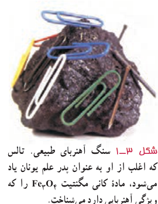
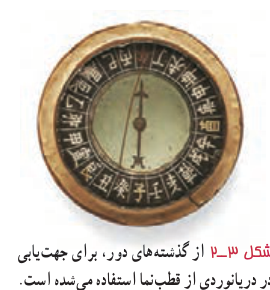
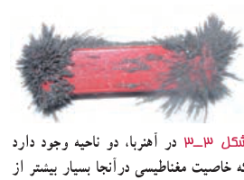
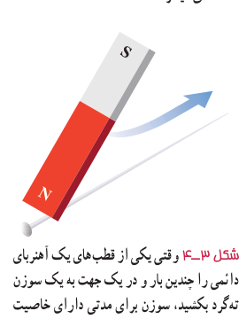

کاربرد مغناطیس و آهنربا در جنبه‌های مختلف زندگی بشر، رشدی روزافزون دارد. فراتر از یک قرن، ضبط صدا و تصویر روی محیط‌هایی انجام می‌گرفت که مغناطیس در آنها نقش اصلی داشت. اگرچه فناوری دیجیتال به میزان زیادی جایگزین ضبط مغناطیسی به شیوه‌های سنتی شده است، با وجود این، ذخیرۀ اطلاعات به‌صورت صفر و یک، هنوز هم در بیشتر روش‌ها به محیط‌های مغناطیسی وابسته است. مغناطیس و آهنرباها همچنین در بلندگوها، گوشی‌های تلفن همراه، رایانه‌ها، کارت‌های بانکی، موتورهای الکتریکی، یخچال‌ها و اغلب سامانه‌های هشدار و ایمنی کاربرد دارند. پزشکی امروز نیز در تشخیص بیماری‌ها به کمک دستگاه‌هایی از قبیل ام‌آرآی (MRI)، بهرۀ فراوانی از مغناطیس و آثار آن می‌برد.

## ۳ـ۱ مغناطیس و قطب‌های مغناطیسی

آثار مغناطیسی دست‌کم ۲۵۰۰ سال پیش در تکه‌هایی از سنگ آهن مغناطیسی شده در نزدیکی شهر باستانی مگنسیا (که نام امروزی آن مانیسا و در غرب ترکیه واقع است) مشاهده شد. این تکه‌ها نمونه‌هایی هستند از چیزی که امروزه آهنربای دائمی خوانده می‌شود (شکل ۳ـ۱). چینی‌های باستان نیز با ویژگی‌های مغناطیسی برخی از سنگ‌های آهنربایی آشنایی داشتند و از آنها در ساخت قطب‌نما برای جهت‌یابی استفاده می‌کردند (شکل ۳ـ۲).

در علوم هشتم دیدید که هرگاه آهنربایی را درون ظرف محتوی برادۀ آهن فرو ببریم، براده‌های آهن به مقدار زیادی جذب ناحیه‌های خاصی از آهنربا می‌شوند. این ناحیه‌ها را قطب‌های مغناطیسی یا قطب‌های آهنربا می‌نامند (شکل ۳ـ۳).

### پرسش ۳ـ۱

فرض کنید دو میلۀ کاملاً مشابه، یکی از جنس آهن و دیگری آهنربا در اختیار دارید. با گفت‌وگو در گروه خود، روشی را پیشنهاد کنید که با استفاده از آن و بدون استفاده از هیچ وسیلۀ دیگر، بتوان میله‌ای را که از جنس آهنرباست مشخص کرد.

هنگامی که یک آهنربای دائمی برای چندین بار و در یک جهت به یک سوزن خیاطی یا سوزن ته‌گرد کشیده شود، سوزن نیز برای مدتی آهنربا می‌شود (شکل ۳ـ۴). اگر این سوزن را به آرامی روی سطح آب درون ظرفی شناور کنیم، یا آن را توسط ریسمانی از وسط آن بیاویزیم که بتواند آزادانه بچرخد، یک سر آن تقریباً به سوی شمال جغرافیایی قرار می‌گیرد. این سر را قطب شمال یا قطب N و سر دیگر را قطب جنوب یا قطب S می‌نامند.

ممکن است مفهوم قطب‌های مغناطیسی به نظر، مشابه مفهوم بارهای الکتریکی باشد و قطب‌های شمال و جنوب، مشابه بارهای مثبت و منفی به نظر بیاید؛ اما بارهای مثبت و منفی مجزا وجود دارند، در حالی که هیچ گواه تجربی بر وجود تک‌قطبی مغناطیسی وجود ندارد؛ قطب‌های مغناطیسی همواره به‌صورت زوج ظاهر می‌شوند.
