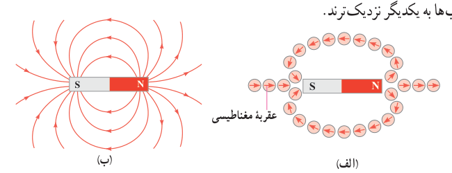
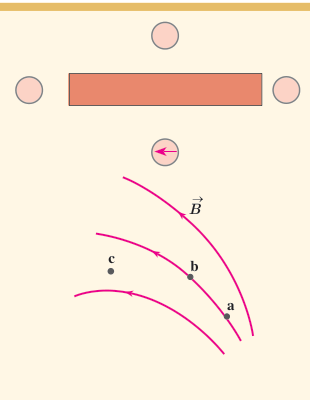
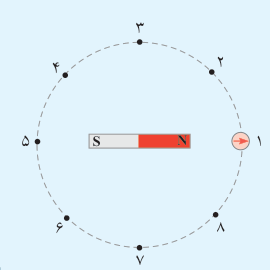

به کمک عقربۀ مغناطیسی می‌توان جهت میدان مغناطیسی را در هر نقطه از فضای اطراف یک آهنربا تعیین کرد (شکل ۳ـ۶ الف). بنا به تعریف، بردار میدان مغناطیسی در هر نقطه از فضای پیرامون یک آهنربا در جهتی است که وقتی عقربۀ مغناطیسی در آن نقطه قرار می‌گیرد، قطب N عقربه، آن جهت را نشان می‌دهد. با تعیین جهت میدان مغناطیسی در هر نقطه از فضای اطراف آهنربا، می‌توان همان‌گونه که برای میدان الکتریکی انجام دادیم، خط‌های میدان مغناطیسی را رسم کنیم. شکل ۳ـ۶ ب خط‌های میدان مغناطیسی را در اطراف یک آهنربای میله‌ای نشان می‌دهد. این خط‌ها از آهنربا می‌گذرند و هریک از آنها یک حلقۀ بسته را تشکیل می‌دهند. افزون بر اینها، خط‌های میدان مغناطیسی در نزدیکی قطب‌ها به یکدیگر نزدیک‌ترند.

### پرسش ۳ـ۳

۱ـ شکل روبه‌رو، یک آهنربای میله‌ای و تعدادی عقربۀ مغناطیسی را نشان می‌دهد. الف) کدام سر آهنربا قطب N و کدام سر قطب S است؟ ب) جهت‌گیری عقربه‌های مغناطیسی را در دیگر مکان‌های روی شکل تعیین کنید.

۲ـ شکل روبه‌رو، خط‌های میدان مغناطیسی در ناحیه‌ای از فضا را نشان می‌دهد. بردار میدان مغناطیسی را در هر یک از نقطه‌های روی شکل رسم کنید. به اندازه و جهت بردار میدان در هر نقطه توجه کنید.

### فعالیت ۳ـ۲

یک آهنربای میله‌ای را روی سطح افقی میزی قرار دهید. یک قطب‌نما یا عقربۀ مغناطیسی را مقابل یکی از قطب‌های آهنربا قرار دهید. عقربه را روی مسیری دایره‌ای شکل دور آهنربا، به آرامی حرکت دهید (شکل روبه‌رو) تا یک دور کامل، دور آهنربا بچرخد و به جای اولش برگردد.

الف) جهت‌گیری عقربه را در نقطه‌های ۱ تا ۸، روی شکل نشان دهید. ب) در این حرکت، عقربه چند دور پیرامون محور خودش می‌چرخد؟

