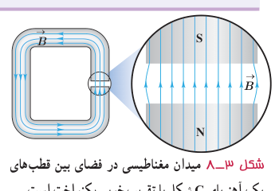

### فعالیت ۳ـ۳

وقتی یک سوزن مغناطیسی شده یا یک عقربۀ مغناطیسی را از وسط آن آویزان می‌کنیم در بیشتر نقاط زمین، به طور افقی قرار نمی‌گیرد و امتداد آن با سطح افقی زمین زاویه می‌سازد. به این زاویه، شیب مغناطیسی گفته می‌شود.

برای یافتن شیب مغناطیسی محلی که در آن زندگی می‌کنید درست به وسط یک سوزن مغناطیسی شده یا عقربۀ مغناطیسی بزرگ، نخی را ببندید و آن را آویزان کنید. پس از تعادل، به کمک نقاله، زاویه‌ای را اندازه بگیرید که امتداد سوزن یا عقربۀ مغناطیسی با راستای افق می‌سازد. عدد به‌دست آمده، شیب مغناطیسی محل زندگی شماست¹. چنانچه در آزمایشگاه مدرسه شیب‌سنج مغناطیسی موجود باشد می‌توانید از آن نیز استفاده کنید.

### خوب است بدانید: جهت‌یابی مغناطیسی در جانداران

بسیاری از موجودات زنده از میدان مغناطیسی زمین برای جهت‌یابی استفاده می‌کنند. خرچنگ خاردار کارائیب در برابر میدان‌های مغناطیسی بسیار حساس است (شکل الف). این جانور یک قطب‌نمای مغناطیسی درونی دارد که تشخیص شمال، جنوب، شرق و غرب را برایش امکان‌پذیر می‌کند. این خرچنگ همچنین می‌تواند تفاوت اندک در میدان مغناطیسی زمین از مکانی به مکان دیگر را حس کند و از این تفاوت، در یافتن مسیر خود بهره بگیرد.

در سال ۱۹۷۵ میلادی، دانشمندان مؤسسۀ فناوری ماساچوست (MIT) هنگام بررسی باکتری‌های موجود در لجن ته باتلاق‌ها، متوجه شدند که این باکتری‌ها دارای قسمت‌هایی کوچک در بدن خود هستند که خاصیت مغناطیسی دارند. این قسمت‌ها به‌صورت زنجیری در یک خط قرار دارند؛ در نتیجه یک عقربۀ مغناطیسی کوچک را تشکیل می‌دهند (شکل ب). باکتری‌ها به کمک این مغناطیس داخلی می‌توانند از میدان مغناطیسی زمین بهره بگیرند و به طرف مواد غذایی در ته آبگیر هدایت شوند. جالب اینکه باکتری‌های مربوط به نیمکرۀ جنوبی زمین، برای رسیدن به ته آبگیر در خلاف جهت خط‌های میدان مغناطیسی زمین قرار می‌گیرند.

**میدان مغناطیسی یکنواخت:** هرگاه در نقاط مختلف ناحیه‌ای از فضا جهت و اندازۀ میدان مغناطیسی یکسان باشد، در این صورت میدان مغناطیسی را در آن ناحیه یکنواخت می‌گویند. ایجاد میدان مغناطیسی یکنواخت در ناحیۀ بزرگی از فضا بسیار دشوار و در عمل امکان‌ناپذیر است. با این وجود، می‌توان در ناحیۀ کوچکی از فضا، مانند ناحیۀ بین قطب‌های یک آهنربای C شکل²، میدان مغناطیسی یکنواخت ایجاد کرد (شکل ۳ـ۸).

۱ـ می‌توانید به سایت www.magnetic-declination.com بروید و درستی شیب مغناطیسی (magnetic inclination) به‌دست آمده در فعالیت ۳ـ۳ را بررسی کنید. یا با نصب برنامۀ inclination meter روی گوشی تلفن همراه خود، شیب مغناطیسی را در محل زندگی خود اندازه بگیرید. شیب مغناطیسی در ایران از حدود ۴۰° تا حدود ۶۰° از مناطق جنوبی تا مناطق شمال غربی متغیر است.

۲ـ C – Shaped Magnet
