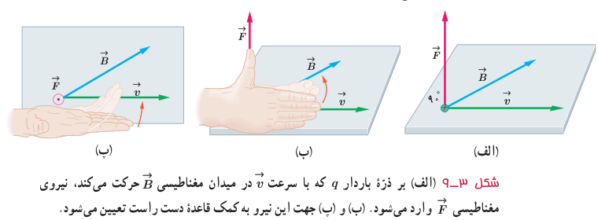
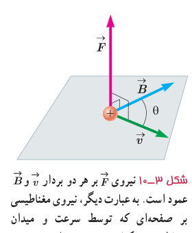
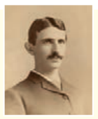

## ۳ـ۳ نیروی مغناطیسی وارد بر ذرۀ باردار متحرک در میدان مغناطیسی

آزمایش نشان می‌دهد که اگر ذرۀ باردار $q$ با سرعت $\vec v$ در میدان مغناطیسی $\vec B$ حرکت کند (به شرط آنکه جهت حرکت آن با میدان مغناطیسی موازی نباشد) بر آن نیرویی وارد خواهد شد که مطابق شکل ۳ـ۹ الف بر راستای سرعت و میدان مغناطیسی عمود است. این نیرو را نیروی مغناطیسی می‌نامند و جهت آن، مطابق شکل ۳ـ۹ ب و پ به کمک قاعدۀ دست راست تعیین می‌شود. اگر دست راست خود را طوری نگه داریم که انگشتان باز شدۀ ما در جهت $\vec v$ باشد ـ به گونه‌ای که وقتی آنها را روی زاویۀ کوچک‌تری که $\vec v$ با $\vec B$ می‌سازد، و در جهت چرخش طبیعی انگشتان خم کنیم در جهت $\vec B$ قرار گیرند ـ انگشت شست ما در جهت نیروی وارد بر ذرۀ باردار مثبت خواهد بود. توجه کنید که نیروی وارد بر بار منفی، در خلاف جهت نیروی وارد بر بار مثبت است.

اندازۀ نیروی مغناطیسی وارد بر بار الکتریکی در حال حرکت از رابطۀ زیر به دست می‌آید:

$$F=|q|vB\sin\theta\qquad (۳-۱)$$

در این رابطه $|q|$ بزرگی بار الکتریکی، $v$ تندی (اندازۀ سرعت) بار الکتریکی، $B$ اندازۀ میدان مغناطیسی و $\theta$ زاویۀ بین جهت حرکت بار الکتریکی (بردار $\vec v$) با جهت میدان مغناطیسی (بردار $\vec B$) است (شکل ۳ـ۱۰).

رابطۀ ۳ـ۱ نشان می‌دهد وقتی بار الکتریکی $q$ عمود بر راستای میدان مغناطیسی حرکت کند ($\sin\theta=\sin90^\circ=1$)، اندازۀ نیروی مغناطیسی وارد بر بار الکتریکی، بیشینه می‌شود ($F=F_{max}$). بنا به رابطۀ ۳ـ۱، یکای SI میدان مغناطیسی معادل است با:

$$\text{یکای SI میدان مغناطیسی}=\frac{\mathrm N}{\mathrm{C.m/s}}=\frac{\mathrm N}{\mathrm{A.m}}$$

این یکا به احترام نیکُلا تسلا دانشمند و مخترع نامی، تسلا نامیده می‌شود و به اختصار با نماد T نشان داده می‌شود. به این ترتیب می‌توان نوشت:

$$1\ \mathrm T=1\frac{\mathrm N}{\mathrm{C.m/s}}=1\frac{\mathrm N}{\mathrm{A.m}}\qquad (۳-۲)$$

⊙ نماد بردار عمود بر صفحه به طرف بیرون (برون‌سو)

⊗ نماد بردار عمود بر صفحه به طرف درون (درون‌سو)

**نیکُلا تسلا (۱۹۴۳–۱۸۵۶)**

تسلا در کرواسی به دنیا آمد. او بعدها به آمریکا مهاجرت و مدتی با ادیسون همکاری کرد. ادیسون همواره با جریان مستقیم (dc) کار می‌کرد، با این وجود، وی کار کردن جریان متناوب (ac) با ولتاژهای بسیار بالا را عملی ساخت. تسلا از اینکه جریان متناوب برای اولین بار در صندلی الکتریکی به منظور اعدام مورد استفاده قرار گرفت شدیداً ناراحت بود. وی همچنین طرح تولید برق در آبشار نیاگارا بود. به پاس خدمات وی، یکای SI میدان مغناطیسی را با تسلا نشان می‌دهند.

