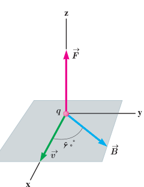
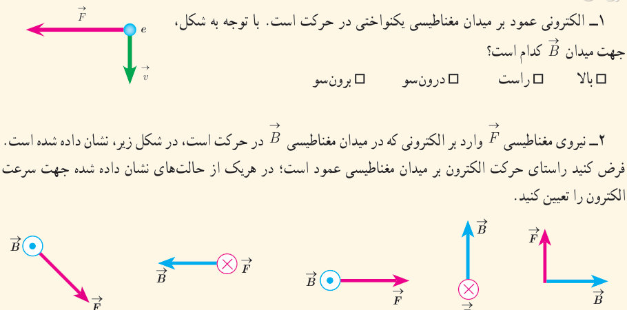
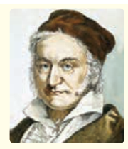

تسلا یکای بزرگی است و در برخی موارد از یکای قدیمی (غیر SI) و کوچک‌تری به نام گاوس (با نماد G) استفاده می‌کنند به طوری که داریم $1\ \mathrm T=10^4\ \mathrm G$. اندازۀ میدان مغناطیسی زمین در نزدیکی سطح زمین در قطب‌ها بیشترین ($0.65\ \mathrm G$) و در استوا کمترین ($0.25\ \mathrm G$) است. بزرگی میدان مغناطیسی در نزدیکی آهنرباهای میله‌ای کوچک حدود ۰/۰۱ تا ۰/۱ تسلا است. همچنین بزرگ‌ترین میدان مغناطیسی مداوم¹ که امروزه در آزمایشگاه تولید شده، حدود ۴۵ تسلا است.

### مثال ۳ـ۱

ذره‌ای با بار $q=+4.0\ \mathrm{nC}$ و با تندی $v=20\ \mathrm{m/s}$ در جهتی حرکت می‌کند که با میدان مغناطیسی یکنواخت $B=120\ \mathrm G$ زاویۀ $\theta=60^\circ$ می‌سازد (شکل روبه‌رو). اندازۀ نیروی مغناطیسی وارد بر این ذره را حساب کنید.

**پاسخ:** با توجه به فرض‌های مسئله داریم:

$$|q|=4.0\times10^{-9}\ \mathrm C,\quad v=20\ \mathrm{m/s},\quad B=120\times10^{-4}\ \mathrm T,\quad\theta=60^\circ$$

با قرار دادن داده‌های بالا در رابطۀ ۳ـ۱ داریم:

$$F=|q|vB\sin\theta=(4.0\times10^{-9}\ \mathrm C)(20\ \mathrm{m/s})(120\times10^{-4}\ \mathrm T)\sin60^\circ\approx8.3\times10^{-10}\ \mathrm N$$

### پرسش ۳ـ۴

۱ـ الکترونی عمود بر میدان مغناطیسی یکنواختی در حرکت است. با توجه به شکل، جهت میدان $\vec B$ کدام است؟ بالا □ راست □ درون‌سو □ برون‌سو □

۲ـ نیروی مغناطیسی $\vec F$ وارد بر الکترونی که در میدان مغناطیسی $\vec B$ در حرکت است، در شکل زیر، نشان داده شده است. فرض کنید راستای حرکت الکترون بر میدان مغناطیسی عمود است؛ در هریک از حالت‌های نشان داده شده جهت سرعت الکترون را تعیین کنید.

**کارل فریدریش گاوس (۱۸۵۵–۱۷۷۷)**

گاوس، ریاضی‌دان، فیزیک‌دان و ستاره‌شناس آلمانی است که مدتی مدیر رصدخانۀ گوتینگن بوده است. گاوس یکی از ریاضی‌دان‌های بزرگ و برجسته‌ترین کارش در نظریۀ اعداد است. او به انجام محاسبه‌های بی‌اندازه بغرنج علاقه‌مند بود. وی همچنین روش‌های تازه‌ای برای محاسبه در مکانیک سماوی به‌دست آورد. گاوس روی پدیده‌های الکتریکی و مغناطیسی نیز فعالیت زیادی کرد و قانونی به نام وی در مبحث الکتریسیته وجود دارد.

۱ـ Strongest Continuous Magnetic Field
