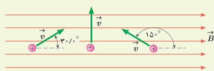
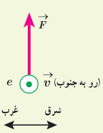
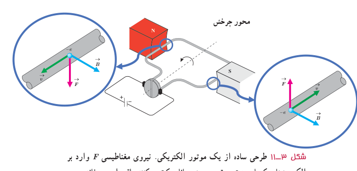

### تمرین ۳ـ۱

۱ـ بر پروتونی که با زاویۀ $\theta=30^\circ$ نسبت به میدان مغناطیسی یکنواختی به اندازۀ $B=320\ \mathrm G$ در حرکت است نیرویی به اندازۀ $F=5.12\times10^{-14}\ \mathrm N$ وارد می‌شود. تندی پروتون چند کیلومتر بر ثانیه است؟

۲ـ سه ذره، هر کدام با بار $q=6.15\ \mathrm{nC}$ و تندی $v=46\ \mathrm{m/s}$، در میدان مغناطیسی یکنواختی به اندازۀ $B=0.165\ \mathrm T$ در حرکت‌اند (شکل روبه‌رو). اندازۀ نیروی وارد بر هر ذره را حساب کنید.

۳ـ الکترونی با تندی $2.4\times10^5\ \mathrm{m/s}$ درون میدان مغناطیسی یکنواختی در حرکت است. اندازۀ نیرویی که از طرف میدان مغناطیسی بر این الکترون وارد می‌شود، هنگامی بیشینه است که الکترون به سمت جنوب حرکت کند.

الف) اگر جهت این نیروی بیشینه، رو به بالا و اندازۀ آن برابر $6.8\times10^{-14}\ \mathrm N$ باشد، اندازه و جهت میدان مغناطیسی را تعیین کنید.

ب) اندازۀ میدان الکتریکی چقدر باشد تا همین نیرو را ایجاد کند؟

## ۳ـ۴ نیروی مغناطیسی وارد بر سیم حامل جریان

موتورهای الکتریکی ابزارهایی هستند که انرژی الکتریکی را به انرژی مکانیکی تبدیل می‌کنند و اساس کار بسیاری از دستگاه‌ها نظیر جاروی برقی، متۀ برقی، آسیاب برقی، ماشین لباس‌شویی، پنکه و ... را تشکیل می‌دهند. شکل ۳ـ۱۱ طرحی ساده از اجزای اصلی یک موتور الکتریکی را نشان می‌دهد که در علوم سال هشتم با نحوۀ ساختن آن آشنا شدید. چه چیز باعث می‌شود یک موتور الکتریکی کار کند؟ در هر موتور الکتریکی، سیم‌هایی وجود دارند که حامل جریان‌اند (یعنی بارهای الکتریکی در آنها در حرکت‌اند) و آهنرباهایی نیز وجود دارند که بر بارهای متحرک نیرو وارد می‌کنند. از این رو، بر هر سیم حامل جریان، نیروی مغناطیسی وارد می‌شود و این نیروها حلقه را می‌چرخانند.

