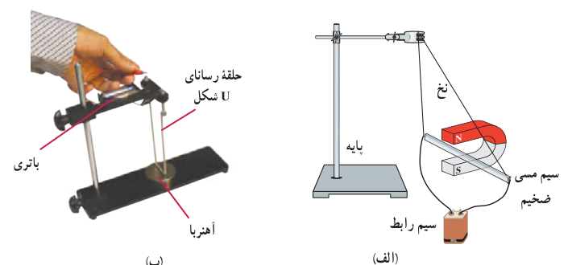
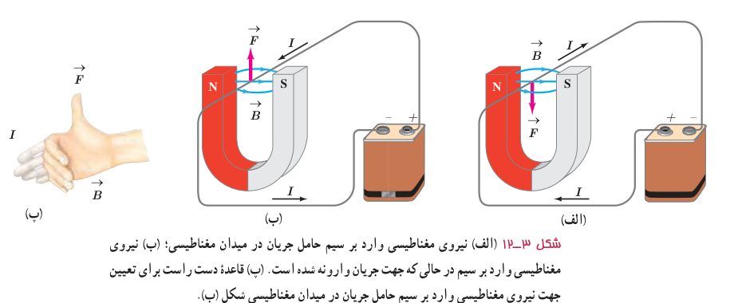

### آزمایش ۳ـ۲

**هدف:** بررسی نیروی وارد بر سیم حامل جریان

**وسیله‌های مورد نیاز:** آهنربای نعلی شکل، سیم مسی ضخیم، سیم رابط، پایه، نخ و باتری

**شرح آزمایش:**

- مداری مطابق شکل الف ببندید تا جریان از سیم مسی بگذرد. آنچه را که مشاهده می‌کنید، در گروه خود به بحث بگذارید.
- در صورتی که وسیله‌ای مشابه شکل ب را در آزمایشگاه مدرسه در اختیار دارید می‌توانید از آن استفاده کنید.
- مدار را قطع کنید و جهت جریان را تغییر داده و مراحل بالا را دوباره انجام دهید.
- نتیجۀ آزمایش را به کلاس گزارش دهید.

اورستد (فیزیک‌دان دانمارکی) با انجام آزمایش‌هایی شبیه آزمایش ۳ـ۲ و اندازه‌گیری نیرویی که بر سیم حامل جریان در میدان مغناطیسی وارد می‌شود، نشان داد:

نیرویی که در میدان مغناطیسی بر سیم حامل جریان الکتریکی وارد می‌شود، بر راستای سیم و نیز بر راستای میدان مغناطیسی عمود است. جهت نیروی وارد بر سیم حامل جریان در میدان مغناطیسی را می‌توان با استفاده از قاعدۀ دست راست تعیین کرد (شکل ۳ـ۱۲).

