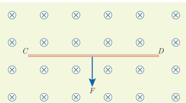
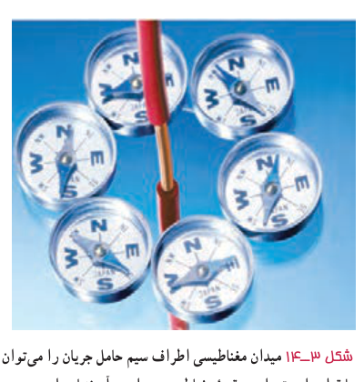
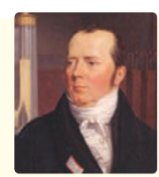

۲ـ سیم رسانای CD به طول $2\ \mathrm m$ مطابق شکل روبه‌رو عمود بر میدان مغناطیسی درون‌سو با اندازۀ $0.5\ \mathrm T$ قرار گرفته است؛ اگر اندازۀ نیروی مغناطیسی وارد بر سیم برابر $1\ \mathrm N$ باشد، جهت و مقدار جریان عبوری از سیم را تعیین کنید.

### فعالیت ۳ـ۴

آزمایشی را طراحی کنید که به کمک آن بتوان نیروی مغناطیسی وارد بر سیم حامل جریان الکتریکی درون میدان مغناطیسی را اندازه‌گیری کرد. در صورت لزوم، برای اجرای این آزمایش می‌توانید از ترازوهای دیجیتال (رقمی) با دقت $0.01\ \mathrm g$ استفاده کنید.

## ۳ـ۵ میدان مغناطیسی حاصل از جریان الکتریکی

تا اینجا پی بردیم که در فضای اطراف آهنرباهای دائمی میدان مغناطیسی وجود دارد. در ادامۀ این فصل با چشمه‌های دیگر ایجاد میدان مغناطیسی آشنا خواهیم شد.

اورستد دانشمند دانمارکی، در سال ۱۸۲۰ میلادی ضمن انجام برخی آزمایش‌های الکتریسیته، مشاهده کرد که عقربۀ مغناطیسی در کنار سیم حامل جریان الکتریکی منحرف می‌شود (شکل ۳ـ۱۴). او با انجام دادن آزمایش‌های بیشتر کشف کرد که عبور جریان الکتریکی از یک سیم رسانا، در اطراف آن یک میدان مغناطیسی به‌وجود می‌آورد. این کشف اورستد گام مهمی در راه درک رابطۀ بین الکتریسیته و مغناطیس بود که به گسترش مبحث الکترومغناطیس انجامید. در این بخش، به بررسی میدان مغناطیسی حاصل از جریان الکتریکی در سیم‌ها می‌پردازیم.

**هانس کریستیان اورستد (۱۸۵۱–۱۷۷۷)**

فیزیک‌دان و شیمی‌دان مشهور دانمارکی است که تأثیر بسیار بزرگی در تاریخ فیزیک گذاشته است. کشفیات وی در زمینۀ الکتریسیته و مغناطیس، اولین گام در شکل‌گیری نظریۀ الکترومغناطیس بود. اورستد که معمولاً در کلاس‌هایش به انجام آزمایش هم می‌پرداخت، در یکی از روزهای سال ۱۸۲۰ میلادی، در حالی که مشغول آموزش الکتریسیته و تولید جریان با پیل الکتریکی بود، متوجه انحراف جهت عقربۀ قطب‌نمایی شد که در کنار سیم حامل جریان قرار داشت. در ابتدا تصور کرد که ممکن است جریان هوای پیرامون سیم حامل جریان سبب انحراف عقربه شده است، اما با انجام آزمایش‌های دقیق‌تر، به ارتباط مستقیم الکتریسیته و مغناطیس پی برد. به دنبال این کشف مهم، دانشمندان دیگری همچون آمپر، فاراده، هانری، ماکسول و هرتز تحقیقات در الکترومغناطیس را ادامه دادند. اورستد در حوزۀ فلسفه هم مطالعاتی داشت و همچنین یکی از دوستان نزدیک داستان‌نویس مشهور کودکان، هانس کریستیان اندرسن بود.

