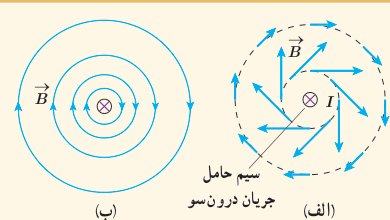
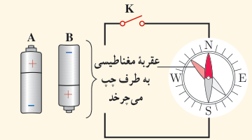
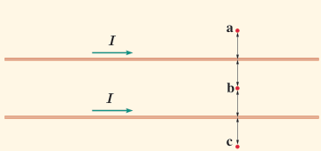

### پرسش ۳ـ۷

۱ـ دریافت خود را از شکل‌های الف و ب بیان کنید. در بیان خود، به چگونگی تغییر جهت و اندازۀ میدان $\vec B$ در اطراف سیم حامل جریان اشاره کنید.

۲ـ کدام باتری را در مدار شکل روبه‌رو قرار دهیم تا پس از بستن کلید K، عقربۀ قطب‌نما که روی سیم قرار دارد، در خلاف جهت حرکت عقربه‌های ساعت شروع به چرخش کند؟ دلیل انتخاب خود را توضیح دهید.

۳ـ جهت میدان مغناطیسی برآیند (خالص) ناشی از سیم‌های موازی و بلند حامل جریان را در هر یک از نقطه‌های a، b و c پیدا کنید. نقطۀ b در فاصلۀ مساوی از دو سیم قرار دارد.

### فناوری و کاربرد: میدان‌های مغناطیسی بدن

تمام یاخته‌های زندۀ بدن انسان به‌طور الکتریکی فعال‌اند. جریان‌های الکتریکی ضعیف در بدن، میدان‌های مغناطیسی ضعیف ولی قابل اندازه‌گیری تولید می‌کنند. اندازۀ میدان‌های حاصل از عضله‌های اسکلتی کوچک‌تر از $10^{-11}\ \mathrm T$، یعنی در حدود یک میلیونیم میدان مغناطیسی زمین است. میدان‌های مغناطیسی حاصل از مغز بسیار ضعیف‌تر و در حدود $10^{-12}\ \mathrm T$ هستند و برای اندازه‌گیری آنها باید مغناطیس‌سنج‌های بسیار حساس به کار برد. در حال حاضر، چنین مغناطیس‌سنج‌هایی به نام اسکوئید¹ ساخته شده‌اند. شکل روبه‌رو یک دستگاه اسکوئید را نشان می‌دهد که در حال اندازه‌گیری میدان مغناطیسی تولید شده در مغز است.

۱ـ SQUID (Superconducting Quantum Interference Device)
