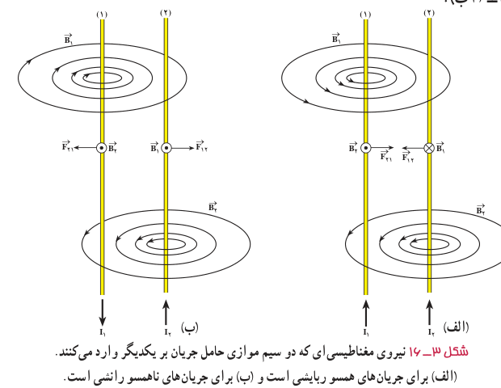
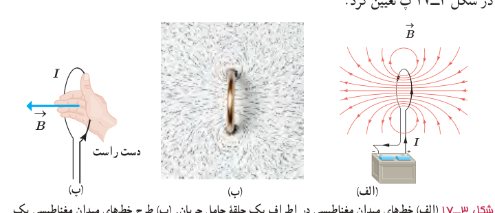

**نیروی بین سیم‌های موازی حامل جریان:** در آزمایش اورستد، دیدیم که در فضای اطراف هر سیم حامل جریان، میدان مغناطیسی وجود دارد. همچنین در بخش ۳ـ۴ با نیروی مغناطیسی وارد بر سیم حامل جریان آشنا شدیم. حال فرض کنید برای تولید میدان مغناطیسی به جای آهنربا، از یک سیم حامل جریان استفاده کنیم. اگر سیم حامل جریان دیگری را در نزدیکی این سیم قرار دهیم، آیا نیرویی بر آن وارد می‌شود؟ آزمایش نشان می‌دهد که پاسخ این پرسش مثبت است. به طوری که اگر جریان‌ها در یک جهت از دو سیم موازی بگذرند، نیروی بین آنها ربایشی است (شکل ۳ـ۱۶ الف). همچنین اگر جریان‌ها در دو جهت مخالف از دو سیم موازی بگذرند، نیروی بین آنها رانشی است (شکل ۳ـ۱۶ ب).

**میدان مغناطیسی ناشی از یک حلقۀ دایره‌ای حامل جریان:** شکل ۳ـ۱۷ الف خط‌های میدان مغناطیسی را در اطراف یک حلقۀ رسانای دایره‌ای نشان می‌دهد که حامل جریان $I$ است. همان‌طور که دیده می‌شود خط‌های میدان مغناطیسی در ناحیۀ داخل حلقه به یکدیگر نزدیک‌ترند؛ یعنی، میدان در این ناحیه قوی‌تر است. افزون بر این، در نقطه‌های روی محور حلقه، میدان موازی محور حلقه است. جهت خط‌های میدان مغناطیسی حلقه را می‌توان با قاعدۀ دست راست به روش نشان داده شده در شکل ۳ـ۱۷ پ تعیین کرد.

