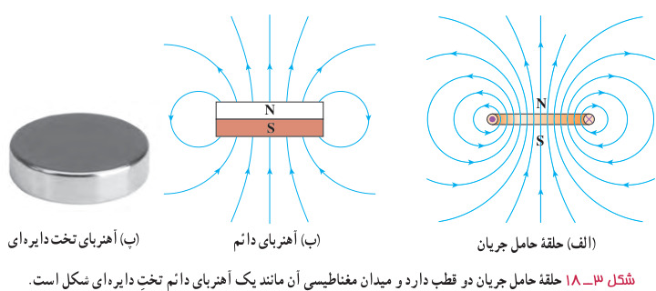
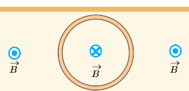
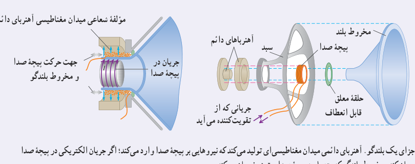

بررسی و مقایسۀ میدان مغناطیسی یک حلقۀ حامل جریان و یک آهنربای تخت دایره‌ای شکل، نشان می‌دهد که میدان مغناطیسی آنها مانند یکدیگر است (شکل ۳ـ۱۸). به همین دلیل، هر حلقۀ حامل جریان را به‌عنوان یک دو قطبی مغناطیسی در نظر می‌گیرند.

### پرسش ۳ـ۸

شکل روبه‌رو، یک حلقۀ حامل جریان را نشان می‌دهد که جهت خط‌های میدان مغناطیسی درون و بیرون آن نشان داده شده است. جهت جریان را در این حلقه تعیین کنید.

### خوب است بدانید: طرز کار بلندگو

یک کاربرد متداول نیروهای مغناطیسی وارد بر سیم حامل جریان، در بلندگوها یافت می‌شود (شکل زیر). میدان مغناطیسی که توسط آهنربای دائمی تولید می‌شود نیرویی بر پیچۀ صدا وارد می‌کند که با جریانی که از پیچه می‌گذرد متناسب است؛ جهت این نیرو بسته به جهت جریان، به طرف راست یا به طرف چپ است. جریانی که از تقویت‌کننده می‌آید هم از نظر جهت و هم از نظر بزرگی نوسان می‌کند. پیچه و مخروط بلندگو که به آن متصل است با دامنه‌ای متناسب با دامنۀ جریان در پیچه، نوسان می‌کند. با افزایش جریانی که از تقویت‌کننده می‌آید، دامنه‌های نوسان و موج صوتی حاصل از حرکت مخروط افزایش می‌یابد.

