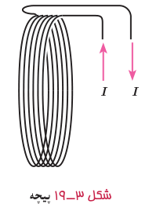
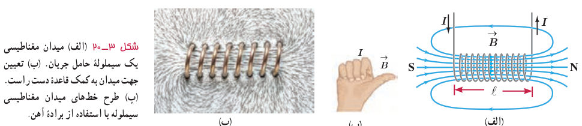

استفاده از یک تک حلقه برای تولید میدانی با اندازۀ مطلوب ممکن است نیازمند آن‌چنان جریان بزرگی باشد که از بیشینۀ جریان مجاز سیم حلقه فراتر باشد. در چنین شرایطی به جای تک‌حلقه، از پیچه‌ها برای تولید میدان مغناطیسی استفاده می‌شود (شکل ۳ـ۱۹). از پیچه‌ها برای تولید میدان مغناطیسی در بسیاری از وسیله‌های برقی استفاده می‌شود.

**میدان مغناطیسی حاصل از سیم‌لولۀ حامل جریان:** سیم‌لوله، سیم درازی است که به‌صورت مارپیچی بلند، پیچیده شده است. با عبور جریان الکتریکی از سیم‌لوله، در فضای اطراف آن میدان مغناطیسی به‌وجود می‌آید. طرح خط‌های میدان مغناطیسی یک سیم‌لولۀ حامل جریان الکتریکی در شکل ۳ـ۲۰ الف و پ نشان داده شده است. همان‌گونه که دیده می‌شود، خط‌های میدان داخل سیم‌لوله بسیار متراکم‌تر از خط‌های میدان در خارج آن است و این نشانگر بزرگ‌تر بودن میدان در داخل سیم‌لوله است. افزون بر این، خط‌های میدان در داخل سیم‌لوله، به‌ویژه در نقطه‌های نسبتاً دور از لبه‌های آن تقریباً موازی و هم‌فاصله‌اند و این، نشانگر یکنواخت بودن میدان مغناطیسی درون سیم‌لوله است. جهت میدان مغناطیسی سیم‌لوله، به کمک قاعدۀ دست راست که در شکل نشان داده شده است تعیین می‌شود (شکل ۳ـ۲۰ ب).

اگر قطر حلقه‌های سیم‌لوله در مقایسه با طول آن، بسیار کوچک و حلقه‌های آن، خیلی به هم نزدیک باشند، به این سیم‌لوله، سیم‌لولۀ آرمانی گفته می‌شود. میدان مغناطیسی داخل یک سیم‌لولۀ آرمانی در نقطه‌های دور از لبه‌ها یکنواخت است و اندازۀ آن از رابطۀ زیر به دست می‌آید:

$$B=\frac{\mu_0NI}{\ell}\qquad\text{(سیم‌لولۀ آرمانی)}\qquad (۳-۴)$$

در این رابطه، $I$ جریان عبوری، $\ell$ طول سیم‌لوله، $N$ تعداد دورهای سیم‌لوله و $\mu_0$ تراوایی مغناطیسی خلأ و برابر $4\pi\times10^{-7}\ \mathrm{T.m/A}$ است.

### مثال ۳ـ۳

سیم‌لوله‌ای آرمانی به طول $15\ \mathrm{cm}$ دارای ۶۰۰ حلقۀ سیم نزدیک به هم است. اگر جریان $800\ \mathrm{mA}$ از سیم‌لوله بگذرد، بزرگی میدان مغناطیسی را در نقطه‌ای درون سیم‌لوله و دور از لبه‌های آن پیدا کنید.

**پاسخ:** با توجه به داده‌های مسئله داریم:

$$\ell=15\ \mathrm{cm}=0.15\ \mathrm m,\quad N=600,\quad I=800\ \mathrm{mA}=800\times10^{-3}\ \mathrm A,\quad B=?$$

به این ترتیب داریم:

$$B=\frac{\mu_0NI}{\ell}=\frac{(4\pi\times10^{-7}\ \mathrm{T.m/A})(600)(800\times10^{-3}\ \mathrm A)}{0.15\ \mathrm m}\approx4.0\times10^{-3}\ \mathrm T=40\ \mathrm G$$
