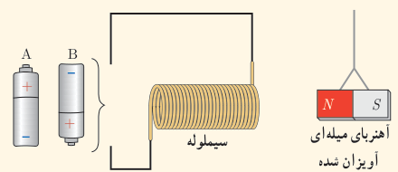
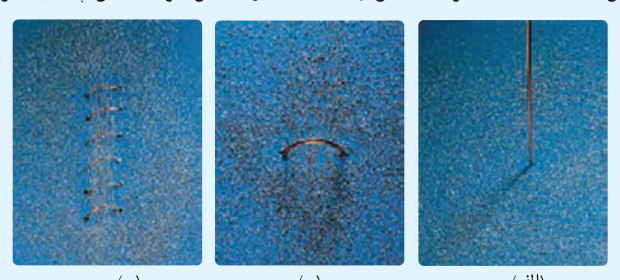
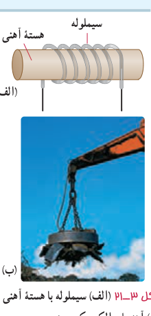

### تمرین ۳ـ۳

سیم‌لوله‌ای آرمانی به طول $40.0\ \mathrm{cm}$ چنان طراحی شده است که جریان بیشینه‌ای به‌شدت $1.2\ \mathrm A$ می‌تواند از آن بگذرد. با عبور این جریان از سیم‌لوله، اندازۀ میدان مغناطیسی درون آن و دور از لبه‌ها ۲۷۰ G می‌شود. تعداد دورهای سیم‌لوله چقدر باید باشد؟

### پرسش ۳ـ۹

کدام باتری را در مدار شکل روبه‌رو قرار دهیم تا آهنربای میله‌ای آویزان شده به طرف سیم‌لوله جذب شود؟ دلیل انتخاب خود را توضیح دهید.

### فعالیت ۳ـ۵

آزمایشی را طراحی و اجرا کنید که به کمک آن بتوان با استفاده از برادۀ آهن، طرح خط‌های میدان مغناطیسی را در اطراف یک سیم بلند (شکل الف)، یک حلقۀ دایره‌ای (شکل ب) و یک سیم‌لولۀ حامل جریان (شکل پ) ایجاد کرد.

**سیم‌لوله با هستۀ آهنی ـ آهنربای الکتریکی:** شکل ۳ـ۲۱ الف سیم‌لوله‌ای با یک هستۀ آهنی را نشان می‌دهد. وقتی جریانی در سیم‌لوله برقرار می‌شود، میدان مغناطیسی سیم‌لوله، در هستۀ آهنی خاصیت مغناطیسی القا می‌کند و هستۀ آهنی، آهنربا می‌شود. این آهنربا را آهنربای الکتریکی می‌نامند. آهنربای الکتریکی صنعتی (شکل ۳ـ۲۱ ب) شامل پیچه‌ای حامل جریان است که تعداد دور سیم زیادی دارد و میدان مغناطیسی حاصل از آن قادر است مقدار زیادی میله‌های فولادی و دیگر قراضه‌های آهن را بلند کند. هر چه تعداد دورهای سیم‌لوله و جریانی که از آن می‌گذرد بیشتر باشد، آهنربای الکتریکی قوی‌تر خواهد بود. وجود هستۀ آهنی باعث تقویت میدان مغناطیسی سیم‌لوله می‌شود. میدان مغناطیسی سیم‌لوله بدون هستۀ آهنی به قدری ضعیف است که در عمل کاربردهای کمی دارد. میدان مغناطیسی درون سیم‌لوله در حالتی که سیم‌لوله دارای هستۀ آهنی باشد، ممکن است ۱۰۰ تا چند هزار برابر بزرگ‌تر از حالتی باشد که سیم‌لوله بدون هسته است.

