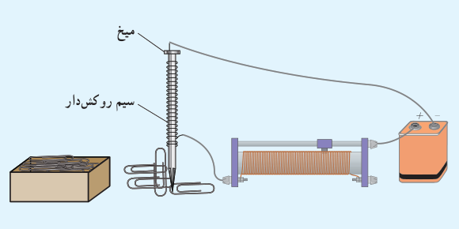
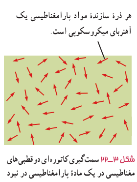

### فعالیت ۳ـ۶

قسمتی از سیم نازک روکش‌داری را دور میخ آهنی نسبتاً بلندی بپیچید و مداری مطابق شکل تشکیل دهید. با تغییر مقاومت رئوستا، جریان عبوری از مدار را تغییر دهید. بررسی کنید برای جریان‌های متفاوت، آهنربای الکتریکی چه تعداد گیرۀ آهنی را می‌تواند بلند کند. ب) اگر تعداد دورهای سیم دو برابر شود، نتیجۀ کار چه تفاوتی خواهد داشت؟

## ۳ـ۶ ویژگی‌های مغناطیسی مواد

رفتار آهنرباهای دائمی، نوارهای مغناطیسی پشت کارت‌های بانکی و دیسک‌های رایانه‌ای به‌طور مستقیم به ویژگی‌های مغناطیسی مواد بستگی دارد.

موادی را که اتم‌ها یا مولکول‌های سازندۀ آنها خاصیت مغناطیسی داشته باشند، مواد مغناطیسی می‌نامند. در واقع می‌توان گفت کوچک‌ترین ذره‌های تشکیل‌دهندۀ این مواد (اتم‌ها یا مولکول‌ها) مانند دوقطبی مغناطیسی رفتار می‌کنند. در این کتاب، دوقطبی‌های مغناطیسی را با یک پیکان کوچک نشان داده‌ایم که می‌توانند جهت‌گیری‌های متفاوتی داشته باشند و هرکدام از آنها وابسته به یک اتم یا مولکول‌اند. در ادامه به بررسی برخی از مواد مغناطیسی می‌پردازیم که می‌توان خواص آنها را با دوقطبی‌های مغناطیسی توضیح داد.

**مواد پارامغناطیسی:** اتم‌های مواد پارامغناطیسی، خاصیت مغناطیسی دارند اما دوقطبی‌های مغناطیسی وابسته به آنها، به‌طور کاتوره‌ای سمت‌گیری کرده‌اند و میدان مغناطیسی خالصی ایجاد نمی‌کنند (شکل ۳ـ۲۲). با قرار دادن مواد پارامغناطیسی درون میدان مغناطیسی خارجی قوی (مثلاً نزدیک یک آهنربای قوی)، دوقطبی‌های مغناطیسی آنها، مانند عقربۀ قطب‌نما در نزدیکی آهنربا رفتار می‌کنند و به مقدار مختصری در راستای خط‌های میدان مغناطیسی منظم می‌شوند. با دور کردن آهنربا از این مواد، دوقطبی‌های مغناطیسی آنها، دوباره به‌طور کاتوره‌ای سمت‌گیری می‌کنند.

به این ترتیب، می‌توان گفت مواد پارامغناطیسی در حضور میدان‌های مغناطیسی قوی، خاصیت مغناطیسی ضعیف و موقت پیدا می‌کنند. اورانیم، پلاتین، آلومینیم، سدیم، اکسیژن و اکسید نیتروژن از جمله مواد پارامغناطیسی‌اند.

### فعالیت ۳ـ۷

یک لولۀ آزمایش را تا نزدیکی لبۀ آن از الکل طبی (اتانول ۹۶ درجه) پُر کنید. در لوله را ببندید و آن را به‌طور افقی قرار دهید. مطابق شکل، یک آهنربای نئودیمیم را بالای حباب هوای درون لوله بگیرید و به‌آرامی آهنربا را حرکت دهید. دلیل آنچه را مشاهده می‌کنید در گروه خود به گفت‌وگو بگذارید.

