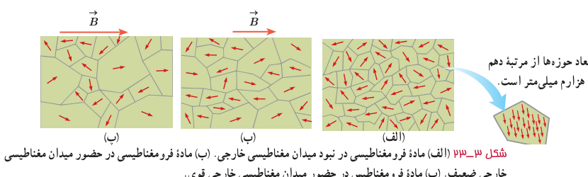

**مواد دیامغناطیسی:** اتم‌های مواد دیامغناطیسی، نظیر مس، نقره، سرب و بیسموت، به‌طور ذاتی فاقد خاصیت مغناطیسی‌اند. به عبارت دیگر، هیچ‌یک از اتم‌های این مواد، دارای دوقطبی مغناطیسی خالصی نیستند. با وجود این، حضور میدان مغناطیسی خارجی، می‌تواند سبب القای دوقطبی‌های مغناطیسی در خلاف سوی میدان خارجی، در مواد دیامغناطیسی شود. توجه داشته باشید که در فعالیت ۳ـ۷، مولکول‌های اتانول خاصیت دیامغناطیسی دارند و حرکت حباب را می‌توان بر این اساس توضیح داد.

**مواد فرومغناطیسی:** نوع دیگری از مواد به نام مواد فرومغناطیسی وجود دارد که اتم‌های آنها به‌طور ذاتی دارای دوقطبی مغناطیسی هستند. آهن، نیکل، کبالت و بسیاری از آلیاژهای دارای این عنصرها فرومغناطیسی‌اند. برهم‌کنش‌های قوی بین دوقطبی‌های مغناطیسی در این مواد موجب می‌شود که این دوقطبی‌ها، حتی در نبود میدان خارجی، در ناحیه‌هایی که حوزه‌های مغناطیسی نامیده می‌شود، همسو شوند. نمونه‌ای از ساختار حوزه‌ها در مواد فرومغناطیسی در شکل ۳ـ۲۳ الف نشان داده شده است.

مواد فرومغناطیسی را می‌توان با قرار دادن در یک میدان مغناطیسی، آهنربا کرد. اثر میدان مغناطیسی خارجی بر حوزه‌های مغناطیسی باعث می‌شود که دوقطبی‌های مغناطیسی هر حوزه تحت تأثیر میدان مغناطیسی قرار گیرند و جهت آنها به جهت میدان خارجی متمایل شود. به این ترتیب، حوزه‌هایی که نسبت به میدان همسو هستند، رشد می‌کنند و حجمشان زیاد می‌شود. از سوی دیگر حجم حوزه‌هایی که سمت‌گیری آنها در راستای میدان نیست، کم می‌شود. در این فرایند، مرز بین بیشتر حوزه‌ها جابه‌جا می‌شود، و ماده خاصیت آهنربایی پیدا می‌کند. شکل ۳ـ۲۳ ب یک مادۀ فرومغناطیسی را در یک میدان مغناطیسی خارجی ضعیف و شکل ۳ـ۲۳ پ در یک میدان مغناطیسی خارجی قوی‌تر نشان می‌دهد.

حوزه‌های مغناطیسی برخی از مواد فرومغناطیسی، در حضور میدان مغناطیسی خارجی به سهولت تغییر می‌کند و ماده به‌سادگی آهنربا می‌شود و با حذف میدان خارجی نیز، خاصیت آهنربایی خود را به‌آسانی از دست می‌دهد. این مواد را مواد فرومغناطیسی نرم می‌نامند. آهن نرم¹ و فولاد کم‌کربن² مثال‌هایی از این دسته مواد هستند. از این مواد در ساخت هستۀ پیچه‌ها و سیم‌لوله‌ها استفاده می‌شود. مواد فرومغناطیسی نرم برای ساختن آهنرباهای الکتریکی (آهنرباهای غیردائم) نیز مناسب‌اند (چرا؟). برخی مواد دیگر مانند فولاد (آهن به اضافۀ ۲ درصد کربن)، آلیاژهای آهن، کبالت و نیکل به سختی آهنربا می‌شوند؛ یعنی در حضور میدان مغناطیسی خارجی، حجم حوزه‌ها در آنها به سختی تغییر می‌کند. این مواد را مواد فرومغناطیسی سخت می‌نامند. در این مواد، سمت‌گیری دوقطبی‌های مغناطیسی حوزه‌ها پس از حذف میدان خارجی، تا مدت زمان زیادی، تقریباً بدون تغییر باقی می‌ماند. به همین دلیل، این مواد برای ساختن آهنرباهای دائمی مناسب‌اند.

۱ـ نرم در عبارت آهن نرم به معنای نرم بودن مکانیکی نیست، بلکه به این معنی است که هم به آسانی خاصیت مغناطیسی پیدا می‌کند و هم به آسانی آن خاصیت را از دست می‌دهد.

۲ـ فولاد کم‌کربن، آلیاژی از آهن و حدود ۰/۰۵٪ تا ۰/۲۵٪ کربن و همچنین عناصر دیگری مانند منگنز یا سیلیسیم است.
