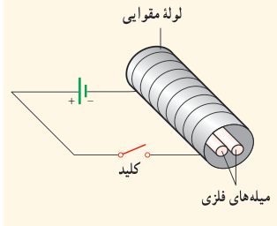
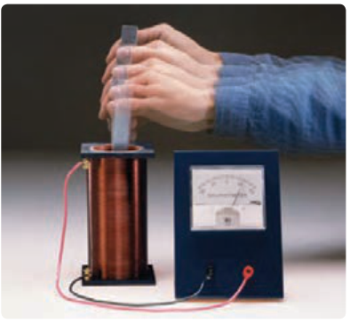

## پرسش ۳ـ۱۰

دو میلۀ فلزی بلند مطابق شکل روبه‌رو درون سیم‌لوله‌ای که دور یک لولۀ مقوایی پیچیده شده است قرار دارند. با بستن کلید و عبور جریان از این سیم‌لوله، مشاهده می‌شود که دو میله از یکدیگر دور می‌شوند. وقتی کلید باز و جریان در مدار قطع می‌شود، میله‌ها به محل اولیۀ بازمی‌گردند.

الف) چرا با عبور جریان از پیچه، میله‌ها از یکدیگر دور می‌شوند؟

ب) با دلیل توضیح دهید میله‌های فلزی از نظر مغناطیسی در کدام دسته قرار می‌گیرند.

## ۳ـ۷ پدیدۀ القای الکترومغناطیسی

تا اینجا، با آثار مغناطیسی جریان الکتریکی آشنا شدید که در سال ۱۸۲۰ میلادی توسط اورستد کشف شد. در سال ۱۸۳۱ فاراده پس از آزمایش‌های فراوان، مشاهده کرد که عبور آهنربا از یک پیچه، سبب برقراری جریان الکتریکی در پیچه می‌شود. این اثر که امروزه به قانون القای الکترومغناطیسی فاراده شناخته می‌شود، اساس کار مولدها برای تولید جریان الکتریکی است. در این بخش، به بررسی القای نیروی محرکۀ الکتریکی در یک مدار بسته خواهیم پرداخت. این پدیده را القای الکترومغناطیسی می‌نامند. با انجام آزمایش زیر با این پدیده بیشتر آشنا می‌شوید.

### آزمایش ۳ـ۴

**هدف: بررسی پدیدۀ القای الکترومغناطیسی**

وسایل‌های مورد نیاز: گالوانومتر، آهنربای میله‌ای، سیم‌لوله یا پیچه و سیم رابط

شرح آزمایش:

- دو سر سیم‌لوله را به گالوانومتر ببندید.
- یکی از قطب‌های آهنربا را وارد سیم‌لوله کنید (شکل روبه‌رو). مشاهدات خود را هنگام انجام این کار، یادداشت کنید.
- اکنون آهنربا را از سیم‌لوله خارج کنید. مشاهدات خود را هنگام انجام این کار، دوباره یادداشت کنید.
- مراحل بالا را برای قطب دیگر آهنربا تکرار کنید.
- آزمایش را در حالی انجام دهید که آهنربا ثابت باشد و سیم‌لوله به آن نزدیک یا از آن دور شود. آیا نتیجۀ آزمایش تغییری می‌کند؟ توضیح دهید.

