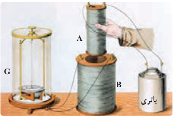
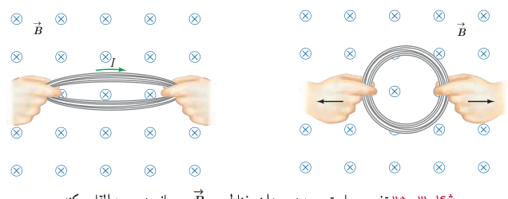
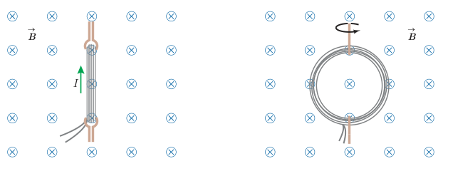

در سال ۱۸۳۱ میلادی مایکل فاراده دانشمند انگلیسی و تقریباً هم‌زمان با او جوزف هانری دانشمند امریکایی، با انجام آزمایش‌هایی مشابه آزمایش ۳ـ۴ دریافتند که هنگام دور و نزدیک کردن آهنربا به پیچه، عقربۀ گالوانومتر منحرف می‌شود و عبور جریانی را از مدار نشان می‌دهد؛ درست مانند وقتی که در مدار، باتری وجود دارد (شکل ۳ـ۲۴). این پدیده را القای الکترومغناطیسی و جریان تولید شده را جریان الکتریکی القایی می‌نامند.

شکل ۳ـ۲۴ فاراده برای پی بردن به پدیدۀ القای الکترومغناطیسی، به جای آهنربای دائمی، از آهنربای الکتریکی (سیم‌لولۀ A که به باتری وصل شده است) استفاده کرد. فاراده مشاهده کرد که با عبور آهنربا از درون سیم‌لولۀ B و تغییر میدان مغناطیسی در محل این سیم‌لوله، عقربۀ گالوانومتر منحرف می‌شود.

پیش از این دیدیم که با تغییر اندازۀ میدان در محل سیم‌لوله، جریان در آن القا می‌شود. به جز این روش، به روش‌های دیگری نیز می‌توان در پیچه یا سیم‌لوله، جریان الکتریکی القا کرد. اگر مساحت پیچه‌ای انعطاف‌پذیر را درون میدان مغناطیسی یکنواخت $\vec B$ تغییر دهیم (شکل ۳ـ۲۵) یا پیچه‌ای را درون میدان مغناطیسی یکنواخت $\vec B$ بچرخانیم (شکل ۳ـ۲۶)، مشاهده می‌شود که در هنگام انجام این کارها، جریانی در پیچه القا می‌شود.

شکل ۳ـ۲۵ تغییر مساحت پیچه در میدان مغناطیسی $\vec B$، جریان در پیچه القا می‌کند.

شکل ۳ـ۲۶ با چرخاندن پیچه درون میدان مغناطیسی $\vec B$، زاویه بین میدان مغناطیسی و سطح پیچه تغییر می‌کند. این تغییر زاویه سبب القای جریان در پیچه می‌شود.

### مایکل فاراده (۱۷۹۱–۱۸۶۷)

مایکل فاراده، پسر یک آهنگر انگلیسی بود. به گفتۀ خود او: «تحصیلات من بسیار معمولی بود. خواندن را کمی بیشتر از حد مقدماتی و نوشتن و ریاضیات را در حد شاگرد یک مدرسۀ روزانه می‌دانستم». ساعت‌های خارج از مدرسه در خیابان و خانه با بازی می‌گذشت. وی در سن ۱۲ سالگی به عنوان شاگرد در یک کتاب‌فروشی مشغول به کار شد. فاراده ۱۹ ساله بود که به او اجازه داده شد تا در جلسۀ سخنرانی سِر همفری دیوی، شیمی‌دان مشهور (۱۷۷۸–۱۸۲۹)، که در مؤسسۀ سلطنتی لندن برگزار می‌شد، حضور یابد. مؤسسۀ سلطنتی یک مرکز مهم پژوهش و آموزش علوم بود. فاراده به شدت علاقه‌مند علوم شد و پیش خود به تحصیل علم شیمی پرداخت. سرانجام در ۱۸۱۳ تقاضای شغلی در مؤسسۀ سلطنتی کرد و دیوی او را به عنوان یک همکار در امور پژوهشی استخدام کرد. فاراده به زودی نبوغ خود را به عنوان یک آزمایشگر نشان داد. وی مقاله‌های مهمی در شیمی، خواص مغناطیسی، الکتریسیته و نور نوشت و سرانجام به عنوان رئیس مؤسسۀ سلطنتی برگزیده شد. فاراده را به سبب کشف‌های بسیارش یکی از بزرگ‌ترین دانشمندان تجربی عصر خود می‌دانند.
