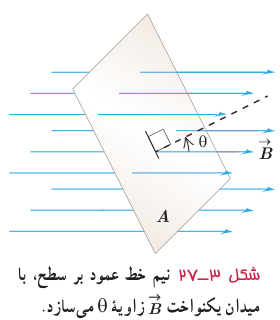
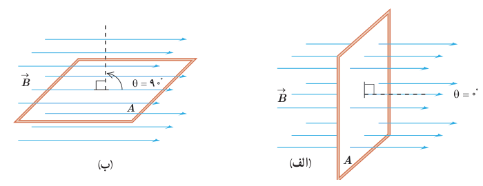

## ۳ـ۸ قانون القای الکترومغناطیسی فاراده

پیش از این دیدیم که به دلایلی مانند تغییر میدان مغناطیسی در محل یک پیچه، تغییر مساحت پیچه در حضور میدان مغناطیسی یا چرخش پیچه درون میدان مغناطیسی، جریان الکتریکی در آن القا می‌شود. عامل اساسی و مشترک در ایجاد جریان القایی در همۀ این آزمایش‌ها، **تغییر شار مغناطیسی** عبوری از پیچه است.

شار مغناطیسی، کمیتی نرده‌ای است و برای میدان مغناطیسی یکنواخت $\vec B$ که از پیچه‌ای با مساحت معین $A$ می‌گذرد به صورت زیر تعریف می‌شود:

$$\Phi=BA\cos\theta \qquad (۳ـ۵)$$

شکل ۳ـ۲۷ نیم‌خط عمود بر سطح، با میدان یکنواخت $\vec B$ زاویۀ $\theta$ می‌سازد.

همان‌طور که در شکل ۳ـ۲۷ دیده می‌شود، $\theta$ زاویه بین بردار میدان مغناطیسی و نیم‌خط عمود بر سطح حلقه است (این نیم‌خط را به طور خط‌چین روی شکل نشان داده‌ایم). یکای SI شار مغناطیسی، وبر (Wb) است که با توجه به رابطۀ ۳ـ۵ داریم: $1\,\mathrm{Wb}=1\,\mathrm T\times1\,\mathrm{m^2}$.

**توجه:** همواره دو جهت برای رسم نیم‌خط عمود بر یک سطح معین وجود دارد. علامت شار مغناطیسی عبوری از این سطح نیز به انتخاب این جهت بستگی دارد. برای مثال، در شکل ۳ـ۲۷، نیم‌خط عمود را در طرفی از سطح رسم کرده‌ایم که زاویۀ بین آن و جهت میدان $\vec B$ کمتر از ۹۰° است و در نتیجه شار عبوری از سطح مثبت می‌شود. اگر نیم‌خط عمود را در طرف دیگر سطح انتخاب کنیم، در این صورت، زاویۀ آن با جهت میدان $\vec B$ بیشتر از ۹۰° خواهد شد و شار عبوری از سطح منفی می‌شود. هر دو انتخاب به یک اندازه مفیدند، ولی در حل یک مسئله، همواره باید یکی را انتخاب کنیم و تا پایان آن را تغییر ندهیم.

### مثال ۳ـ۴

الف) مطابق شکل الف، سطح حلقۀ رسانایی، به شکل مربع با ضلع $20\,\mathrm{cm}$، عمود بر میدان مغناطیسی یکنواختی به بزرگی $250\,\mathrm G$ قرار دارد. شار عبوری از این حلقه را به‌دست آورید.

ب) اگر حلقه را بچرخانیم به طوری که سطح حلقه موازی با خط‌های میدان مغناطیسی شود، شار مغناطیسی عبوری از آن چقدر می‌شود؟

پ) تغییر شار مغناطیسی عبوری از حلقه را وقتی از موقعیت شکل الف به موقعیت شکل ب می‌چرخد به‌دست آورید.

ت) اگر این تغییر شار مغناطیسی در بازۀ زمانی $\Delta t=0.01\,\mathrm s$ رخ داده باشد، آهنگ تغییر شار $(\Delta\Phi/\Delta t)$ را پیدا کنید.

