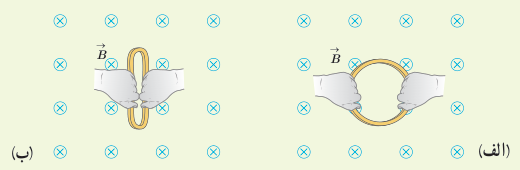

**پاسخ:** الف) وقتی مطابق شکل الف، سطح حلقه عمود بر خط‌های میدان مغناطیسی قرار می‌گیرد، زاویه بین میدان $\vec B$ و نیم‌خط عمود بر سطح حلقه برابر صفر می‌شود. به این ترتیب، شار عبوری از سطح حلقه برابر است با

$$A=0.2\,\mathrm m\times0.2\,\mathrm m=0.04\,\mathrm{m^2},\qquad B=250\,\mathrm G=2.50\times10^{-2}\,\mathrm T,\qquad \theta=0^\circ$$
$$\Phi=BA\cos\theta=(2.50\times10^{-2}\,\mathrm T)(0.04\,\mathrm{m^2})(\cos0^\circ)=1\times10^{-3}\,\mathrm{Wb}=1\,\mathrm{mWb}$$

ب) وقتی مطابق شکل ب، حلقه می‌چرخد و سطح آن موازی با خط‌های میدان مغناطیسی قرار می‌گیرد، زاویه بین میدان $\vec B$ و نیم‌خط عمود بر سطح حلقه برابر ۹۰° می‌شود. از آنجا که $\cos90^\circ=0$ است، در این شرایط، هیچ شاری از سطح حلقه عبور نمی‌کند.

پ) همان‌طور که دیدید شار عبوری از سطح حلقه در وضعیت شکل الف و وضعیت شکل ب، به‌ترتیب، برابر $\Phi_1=1\,\mathrm{mWb}$ و $\Phi_2=0$ است. به این ترتیب، تغییر شار عبوری از سطح حلقه برابر $\Delta\Phi=\Phi_2-\Phi_1=-1\,\mathrm{mWb}$ می‌شود. علامت منفی نشان می‌دهد در حین چرخش حلقه از وضعیت شکل الف به وضعیت شکل ب، شار مغناطیسی عبوری از سطح آن کاهش یافته است.

ت) با توجه به نتیجۀ قسمت پ، آهنگ تغییر شار $(\Delta\Phi/\Delta t)$ برابر است با

$$\frac{\Delta\Phi}{\Delta t}=\frac{-1\times10^{-3}\,\mathrm{Wb}}{0.01\,\mathrm s}=-0.1\,\mathrm{Wb/s}$$

### تمرین ۳ـ۴

الف) حلقه‌ای به مساحت $25\,\mathrm{cm^2}$ درون میدان مغناطیسی یکنواخت درون‌سویی به اندازۀ $0.030\,\mathrm T$ قرار دارد (شکل الف). شار مغناطیسی عبوری از حلقه را به دست آورید.

ب) اگر مطابق شکل ب و بدون تغییر $\vec B$، مساحت سطح حلقه را به $10\,\mathrm{cm^2}$ برسانیم، شار مغناطیسی عبوری از حلقه را در این وضعیت به دست آورید.

پ) اگر این تغییر شار در بازۀ زمانی $\Delta t=0.20\,\mathrm s$ رخ داده باشد، آهنگ تغییر شار $(\Delta\Phi/\Delta t)$ را پیدا کنید.

### پرسش ۳ـ۱۱

کدام‌یک از یکاهای زیر معادل یکای وبر بر ثانیه (Wb/s) است؟

☐ V/A　☐ V　☐ A　☐ Ω

اکنون که با تعریف و مفهوم شار مغناطیسی آشنا شدید دوباره نگاهی می‌کنیم به پدیدۀ القای الکترومغناطیسی که در بخش قبل بررسی کردیم. همان‌طور که گفتیم عامل مشترک در تمامی پدیده‌هایی که منجر به تولید جریان القایی در مدار می‌شود، تغییر شار مغناطیسی عبوری از پیچه یا سیم‌لوله است. بنابر قانون فاراده، هرگاه شار مغناطیسی‌ای که از مدار بسته‌ای می‌گذرد تغییر کند، نیروی محرکه‌ای در آن القا می‌شود که بزرگی آن با آهنگ تغییر شار مغناطیسی متناسب است؛ یعنی هرچه آهنگ تغییر
