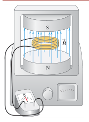

شار مغناطیسی بیشتر باشد، نیروی محرکۀ القایی و در نتیجه جریان القایی تولید شده در مدار بیشتر خواهد بود. مثلاً در آزمایش‌های بخش ۳ـ۷، هر چه حرکتی که سبب تغییر شار مغناطیسی می‌شود سریع‌تر انجام شود، عقربۀ گالوانومتر بیشتر منحرف می‌شود، و این نشان می‌دهد که جریان القایی بزرگ‌تری به‌وجود آمده است.

قانون فاراده برای پیچه یا سیم‌لوله‌ای که از $N$ دور مشابه تشکیل شده باشد با رابطۀ زیر بیان می‌شود:

$$\mathcal E_{av}=-N\frac{\Delta\Phi}{\Delta t}\qquad (۳ـ۶)$$

در این رابطه $\mathcal E_{av}$ نیروی محرکۀ القایی متوسط برحسب ولت و $\Delta\Phi/\Delta t$ آهنگ تغییر شار مغناطیسی برحسب وبر بر ثانیه (Wb/s) است. اگر مقاومت پیچه یا سیم‌لوله برابر $R$ باشد، جریان القایی متوسط در آن از رابطۀ زیر محاسبه می‌شود:

$$I_{av}=\frac{\mathcal E_{av}}R\qquad (۳ـ۷)$$

همان‌طور که از رابطۀ ۳ـ۷ دیده می‌شود، هرچه مقاومت پیچه یا مداری که در آن شار مغناطیسی تغییر می‌کند، بیشتر باشد، جریان کوچک‌تری در آن القا می‌شود.

### مثال ۳ـ۵

پیچه‌ای شامل ۲۰۰ دور که مساحت هر حلقۀ آن $25\,\mathrm{cm^2}$ است، مطابق شکل روبه‌رو بین قطب‌های یک آهنربای الکتریکی قرار گرفته است که میدان مغناطیسی یکنواخت تولید می‌کند. خط‌های میدان بر سطح پیچه عمودند. اگر اندازۀ میدان در بازۀ زمانی $2.0\,\mathrm{ms}$ از $0.18\,\mathrm T$ به $0.22\,\mathrm T$ افزایش یابد،

الف) نیروی محرکۀ القایی متوسط ایجاد شده در پیچه چقدر است؟

ب) اگر مقاومت پیچه $1.0\,\Omega$ باشد، جریان القایی متوسط که از پیچه می‌گذرد چقدر است؟

**پاسخ:** الف) نیم‌خط عمود بر سطح حلقه‌های پیچه را همسو با $\vec B$ می‌گیریم. با توجه به داده‌های مسئله داریم:

$$N=200\ \text{دور},\quad A=25\,\mathrm{cm^2},\quad\theta=0^\circ,\quad\Delta t=2.0\,\mathrm{ms}$$
$$B_1=0.18\,\mathrm T,\quad B_2=0.22\,\mathrm T,\quad\mathcal E_{av}=?$$
$$\Phi_1=B_1 A\cos\theta=(0.18\,\mathrm T)(2.5\times10^{-3}\,\mathrm{m^2})(\cos0^\circ)=4.5\times10^{-4}\,\mathrm{Wb}$$
$$\Phi_2=B_2 A\cos\theta=(0.22\,\mathrm T)(2.5\times10^{-3}\,\mathrm{m^2})(\cos0^\circ)=5.5\times10^{-4}\,\mathrm{Wb}$$

به این ترتیب، تغییر شار مغناطیسی برابر است با:

$$\Delta\Phi=\Phi_2-\Phi_1=(5.5\times10^{-4})-(4.5\times10^{-4})=1.0\times10^{-4}\,\mathrm{Wb}$$

با قرار دادن این مقدار و داده‌های بالا در رابطۀ ۳ـ۶ داریم:

$$\mathcal E_{av}=-N\frac{\Delta\Phi}{\Delta t}=-(200)\frac{1.0\times10^{-4}\,\mathrm{Wb}}{2.0\times10^{-3}\,\mathrm s}=-10\,\mathrm V$$

ب) با توجه به رابطۀ ۳ـ۷، جریان القایی متوسط در پیچه برابر است با:

$$I_{av}=\frac{\mathcal E_{av}}R=\frac{-10\,\mathrm V}{1.0\,\Omega}=-10\,\mathrm A$$
