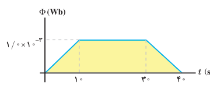
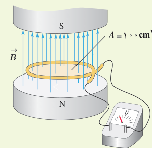
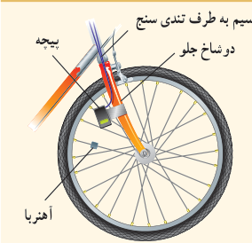

### مثال ۳ـ۶

تغییرات شار مغناطیسی که از یک حلقه می‌گذرد برحسب زمان در نمودار شکل روبه‌رو نشان داده شده است. نیروی محرکۀ القایی متوسط در حلقه را در هریک از بازه‌های زمانی $(0,10\,\mathrm s)$، $(10\,\mathrm s,30\,\mathrm s)$ و $(30\,\mathrm s,40\,\mathrm s)$ محاسبه کنید.

**پاسخ:** در بازۀ زمانی صفر تا $10\,\mathrm s$، نیروی محرکۀ القایی متوسط برابر است با:

$$\mathcal E_{av}=-N\frac{\Delta\Phi}{\Delta t}=-(1)\frac{1.0\times10^{-2}\,\mathrm{Wb}-0}{10\,\mathrm s}=-1.0\times10^{-3}\,\mathrm V$$

در بازۀ زمانی $10\,\mathrm s$ تا $30\,\mathrm s$ شار ثابت مانده است. در نتیجه نیروی محرکۀ القایی متوسط برابر صفر است. در بازۀ زمانی $30\,\mathrm s$ تا $40\,\mathrm s$ شبیه آنچه در مورد بازۀ زمانی صفر تا $10\,\mathrm s$ گفتیم، نیروی محرکۀ القایی متوسط برابر $1.0\times10^{-3}\,\mathrm V$ است.

### تمرین ۳ـ۵

۱ـ میدان مغناطیسی بین قطب‌های آهنربای الکتریکی شکل روبه‌رو که بر سطح حلقه عمود است با زمان تغییر می‌کند و در مدت $0.25\,\mathrm s$ از $0.28\,\mathrm T$، رو به بالا، به $0.17\,\mathrm T$، رو به پایین می‌رسد. در این مدت،

الف) نیروی محرکۀ القایی متوسط در حلقه را به‌دست آورید.

ب) اگر مقاومت حلقه $1.0\,\Omega$ باشد، جریان القایی متوسط در حلقه را پیدا کنید.

۲ـ مساحت هر حلقۀ پیچه‌ای $30\,\mathrm{cm^2}$ و پیچه متشکل از ۱۰۰۰ حلقه است. در ابتدا سطح حلقه‌ها بر میدان مغناطیسی زمین عمود است. اگر در مدت $0.020\,\mathrm s$ پیچه بچرخد و سطح حلقه‌ها موازی میدان مغناطیسی زمین شود، نیروی محرکۀ القایی متوسط در آن چقدر است؟ (اندازۀ میدان مغناطیسی زمین را $0.50\,\mathrm G$ درنظر بگیرید.)

### پرسش ۳ـ۱۲

تندی‌سنج دوچرخه‌های مسابقه‌ای شامل یک آهنربای کوچک و یک پیچه است. آهنربا به یکی از پره‌های چرخ جلو و پیچه به دو شاخ فرمان متصل است (شکل روبه‌رو). دو سر پیچه با سیم‌های رسانا به نمایشگر تندی‌سنج (که در واقع نوعی رایانۀ کوچک است) وصل شده است. به نظر شما تندی‌سنج دوچرخه چگونه کار می‌کند؟ این موضوع را در گروه خود به گفت‌وگو بگذارید و نتیجه را به کلاس درس ارائه دهید.

