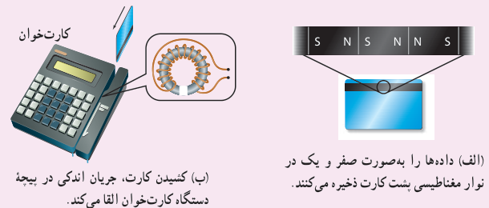
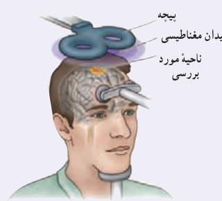

### فناوری و کاربرد: کارت‌های اعتباری و دستگاه‌های کارت‌خوان

نوار مغناطیسی پشت کارت‌های اعتباری حاوی تعداد بسیار زیادی ذرۀ فرومغناطیسی است که نوعی چسب خاص آنها را به هم متصل می‌کند. داده‌ها را که به‌صورت دودویی، با صفر و یک به رمز درآورده‌اند، در نوار مغناطیسی پشت کارت ذخیره می‌کنند (شکل الف). وقتی کارت اعتباری درون دستگاه کارت‌خوان کشیده می‌شود، میدان مغناطیسی ناشی از نوار مغناطیسی، روی پیچۀ قرار داده شده در دستگاه کارت‌خوان اثر می‌گذارد و جریان اندکی را در پیچه القا می‌کند (شکل ب). این جریان بسیار کوچک توسط دستگاه دیگری تقویت و داده‌های ذخیره شده در نوار مغناطیسی پشت کارت، رمزگشایی می‌شود. پس از رمزگشایی داده‌ها، دستور مورد نظر انجام می‌شود.

الف) داده‌ها را به‌صورت صفر و یک در نوار مغناطیسی پشت کارت ذخیره می‌کنند. ب) کشیدن کارت، جریان اندکی در پیچۀ دستگاه کارت‌خوان القا می‌کند.

### خوب است بدانید: معاینۀ مغز با نیروهای محرکۀ القایی

برانگیزش (تحریک) مغناطیسی فرا جمجمه‌ای (TMS)¹ روشی برای بررسی عملکرد بخش‌های مختلف مغز است. در این روش، پیچه‌ای روی سر شخص بیمار قرار داده می‌شود که جریان الکتریکی متغیری از آن می‌گذرد و در نتیجه میدان مغناطیسی متغیری تولید می‌کند. این میدان متغیر، سبب ایجاد نیروی محرکۀ القایی و جریان القایی در ناحیه‌ای از مغز می‌شود که در زیر پیچه قرار دارد. پزشک با مشاهدۀ واکنش مغز (مثلاً اینکه کدام عضله‌ها به علت برانگیزش بخش خاصی از مغز حرکت می‌کنند) می‌تواند شرایط عصب‌شناختی مختلفی را بیازماید.

## ۳ـ۹ قانون لنز

مدت کوتاهی پس از آنکه فاراده قانون القای الکترومغناطیسی را ارائه کرد، هاینریش لنز، دانشمند روس‌تبار، در سال ۱۸۳۴ میلادی روشی را برای تعیین جهت جریان القایی در یک پیچه یا در هر مدار بستۀ دیگری پیشنهاد کرد. این روش که بعدها به قانون لنز شهرت یافت، حاکی از آن است که:

جریان حاصل از نیروی محرکۀ القایی در یک مدار یا پیچه در جهتی است که آثار مغناطیسی ناشی از آن، با عامل به‌وجود آورندۀ جریان القایی، یعنی تغییر شار مغناطیسی، مخالفت می‌کند.

علامت منفی در رابطۀ ۳ـ۶ نشان دهندۀ همین مخالفت است. توضیح دقیق‌تر این مطلب فراتر از سطح این کتاب است. در اینجا تنها به ذکر مثال‌هایی از چگونگی استفاده از قانون لنز برای تعیین جهت جریان القایی اکتفا می‌کنیم.

۱ـ Transcranial Magnetic Stimulation (TMS)
