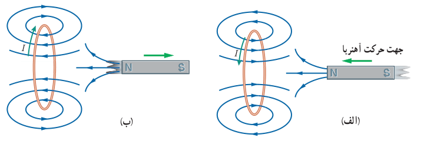
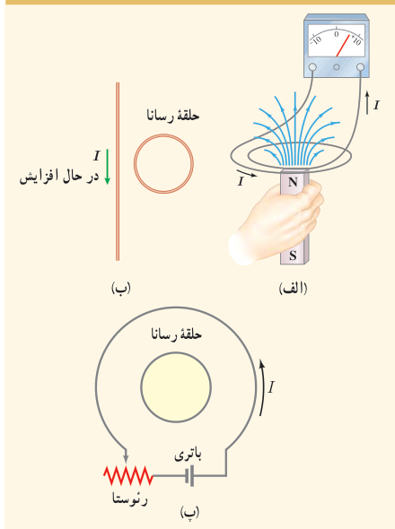

شکل ۳ـ۲۸ الف، آهنربایی را نشان می‌دهد که قطب N آن در حال نزدیک شدن به یک حلقۀ رساناست. در این وضعیت اندازۀ $\vec B$ در محل حلقه افزایش می‌یابد و در نتیجه شار گذرنده از حلقه زیاد می‌شود. بنا به قانون لنز، جهت جریان القایی ایجاد شده در حلقه چنان است که میدان مغناطیسی ناشی از آن با افزایش شار مخالفت کند. بنابراین، میدان مغناطیسی حلقه در خلاف سوی میدان مغناطیسی آهنربا می‌شود. با توجه به قاعدۀ دست راست و از روی جهت میدان مغناطیسی حلقه، جهت جریان در حلقه تعیین می‌شود. همچنین اگر مطابق شکل ۳ـ۲۸ ب، قطب N آهنربا را از حلقۀ رسانا دور کنیم، جریان القایی در جهتی خواهد بود که میدان مغناطیسی تولید شده توسط حلقه، همسو با میدان آهنربا می‌شود و به این ترتیب با کاهش شار عبوری از حلقه، مخالفت می‌کند.

شکل ۳ـ۲۸ الف) وقتی آهنربا به حلقۀ رسانا نزدیک می‌شود جریان در جهتی در حلقه القا می‌شود که میدان مغناطیسی ناشی از آن با افزایش شار مغناطیسی حلقه مخالفت کند. ب) با دور شدن آهنربا از حلقۀ رسانا، جریان در جهتی در حلقه القا می‌شود که میدان مغناطیسی ناشی از آن با کاهش شار مغناطیسی حلقه مخالفت کند.

### هاینریش فریدریش امیل لنز (۱۸۰۴–۱۸۶۵)

از فیزیک‌دانان مشهور آلمانی و اهل بالتیک تبار روس بود. وی در استونی که در آن دوران تحت امپراتوری روسیه بود به دنیا آمد. پس از اتمام دورۀ دبیرستان در سال ۱۸۲۰ وارد دانشگاه گشت و در آنجا به تحصیل در زمینۀ فیزیک و شیمی پرداخت. لنز طی سال‌های ۱۸۲۳ تا ۱۸۲۶ میلادی، در ضمن یک سفر دریایی به دور دنیا، به مطالعۀ شرایط آب و هوایی و همچنین ویژگی‌های فیزیکی دریا پرداخت و نتایج آن را در سال ۱۸۳۱ منتشر کرد. پس از این سفر، در دانشگاه سن پترزبورگ آغاز به کار نمود. لنز مطالعۀ الکترومغناطیس را در سال ۱۸۳۱ شروع کرد و بیشتر شهرتش برای فرمول‌بندی قانون لنز در الکترومغناطیس در سال ۱۸۳۴ است.

### پرسش ۳ـ۱۳

۱ـ با توجه به جهت جریان القایی در مدار شکل الف، توضیح دهید که آیا آهنربا رو به بالا حرکت می‌کند یا رو به پایین.

۲ـ شکل ب سیم بلند و مستقیمی را نشان می‌دهد که جریان عبوری از آن در حال افزایش است. جهت جریان القایی را در حلقۀ رسانای مجاور سیم تعیین کنید.

۳ـ اگر در مدار شکل پ مقاومت رئوستا افزایش یابد، جریان القایی در حلقۀ رسانای داخلی در چه جهتی ایجاد می‌شود؟

