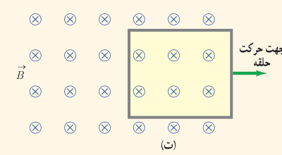
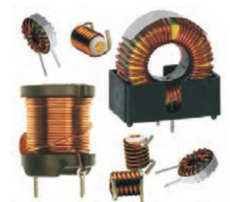

۴ـ حلقۀ رسانای مستطیل شکلی را مطابق شکل ت به‌طرف راست می‌کشیم و از میدان مغناطیسی درون‌سویی خارج می‌کنیم. جهت جریان القایی در حلقه در چه جهتی است؟

### خوب است بدانید: اثر دیامغناطیس

چرخش هر الکترون به دور هستۀ اتم را می‌توان به صورت یک حلقۀ میکروسکوپی جریان مدل‌سازی کرد. هرگاه ماده‌ای در یک میدان مغناطیسی خارجی قرار گیرد، شار مغناطیسی گذرنده از هر یک از این حلقه‌های میکروسکوپی افزایش می‌یابد و در نتیجه بنابر قانون لنز، در این حلقه‌ها، یک میدان مغناطیسی در خلاف جهت میدان مغناطیسی خارجی القا می‌شود. به این ویژگی که در اتم‌های همۀ مواد در حضور یک میدان مغناطیسی خارجی رخ می‌دهد، پدیده یا اثر دیامغناطیس گفته می‌شود. اثر دیامغناطیسی در موادی نظیر بیسموت، جیوه، نقره، سرب، مس و کربن (الماس) بهتر نمایان می‌شود، زیرا اتم‌های آنها، فاقد دو قطبی‌های مغناطیسی دائمی‌اند. از آنجا که اثر دو قطبی‌های مغناطیسی دائمی در مواد فرومغناطیسی و پارامغناطیسی بسیار بیشتر از اثر دو قطبی‌های القایی است، اثر دیامغناطیس در این گونه مواد نمود کمتری دارد.

## ۳ـ۱۰ القاگرها

در فصل ۲ دیدیم که در فضای بین صفحه‌های یک خازن باردار، میدان الکتریکی ایجاد می‌شود و انرژی الکتریکی در این میدان ذخیره می‌شود. به همین ترتیب، می‌توان از القاگر (سیم‌پیچ) برای تولید میدان مغناطیسی دلخواه و همچنین ذخیرۀ انرژی در این میدان استفاده کرد. القاگر مانند مقاومت و خازن یکی از اجزای ضروری مدارهای الکترونیکی است.

شکل ۳ـ۲۹ تصویر چند القاگر را در اندازه‌ها و شکل‌های متفاوت نشان می‌دهد. نماد مداری القاگر، —∿∿∿— است. ویژگی‌های فیزیکی هر القاگر، توسط **ضریب القاوری** آن تعیین می‌شود. ضریب القاوری که با نماد $L$ نمایش داده می‌شود به عواملی همچون تعداد دور، طول و سطح مقطع القاگر و جنس هسته‌ای که داخل آن قرار می‌گیرد بستگی دارد. یکای SI ضریب القاوری، هانری (H) نام دارد.

### جوزف هانری (۱۷۹۷–۱۸۷۸)

یکی از فیزیک‌دانان تجربی قرن نوزدهم است که در امریکا به دنیا آمد و کار خود را با آموزش علوم در یک مدرسۀ روستایی آغاز کرد. سپس به تحصیل در طب و مهندسی علاقه‌مند شد و سرانجام به فیزیک و ریاضیات روی آورد. هانری در سال ۱۸۳۱، همزمان و مستقل از فاراده، موفق به کشف پدیدۀ القای الکترومغناطیسی شد. وی همچنین توانست نوعی موتور الکترومغناطیسی و یک تلگراف جدید و کارآمد اختراع کند. یکای SI ضریب القاوری به احترام یک عمر فعالیت‌های علمی وی، هانری (H) انتخاب شده است.
