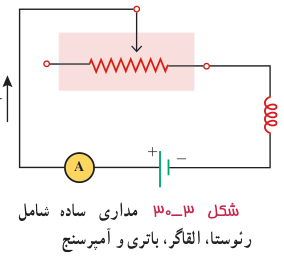
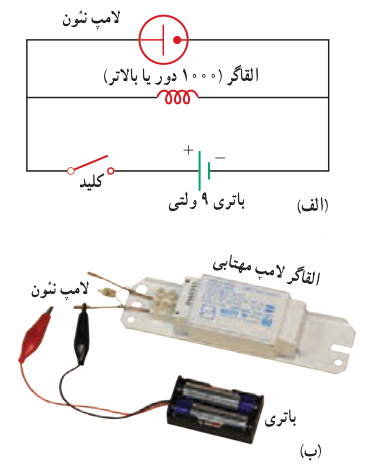

**خود ـ القاوری:** مداری را مطابق شکل ۳ـ۳۰ درنظر بگیرید. این مدار شامل منبع نیروی محرکه، رئوستا، آمپرسنج و القاگری است که به طور متوالی به یکدیگر بسته شده‌اند. با تغییر مقاومت رئوستا، جریان در مدار تغییر می‌کند. تغییر جریان در مدار، سبب تغییر میدان مغناطیسی القاگر می‌شود و در نتیجه شار مغناطیسی عبوری از آن نیز تغییر می‌کند. این فرایند سبب القای نیروی محرکه‌ای در القاگر می‌شود که بنابر قانون لنز با تغییر جریان عبوری از آن مخالفت می‌کند. این پدیده که می‌تواند در هر القاگری (از قبیل پیچه یا سیم‌لوله) رخ دهد اثر **خود ـ القاوری** نامیده می‌شود.

### آزمایش ۳ـ۵

**هدف: بررسی اثر خود ـ القاوری**

وسیله‌های مورد نیاز: لامپ نئون (لامپ فازمتری)، القاگر (۱۰۰۰ دور یا بالاتر)، باتری قلمی (۲ عدد) یا باتری ۹ ولتی، سیم رابط، کلید

شرح آزمایش:

- مداری مطابق شکل الف ببندید.
- کلید را وصل کنید. آیا لامپ روشن است؟ اینک کلید را قطع کنید. در لحظۀ قطع کردن کلید چه چیزی مشاهده می‌کنید؟ دلیل آنچه را مشاهده می‌کنید در گروه خود به گفت‌وگو بگذارید و نتیجه را به کلاس ارائه دهید.

توجه: می‌توانید مطابق شکل ب، به جای القاگر از القاگر لامپ‌های مهتابی (که به اشتباه ترانس نامیده می‌شود) نیز استفاده کنید.

### خوب است بدانید: کاربرد القاگرها در سامانه‌های انتقال برق

برخورد آذرخش به بخشی از یک سامانۀ انتقال توان الکتریکی موجب افزایش ناگهانی ولتاژ می‌شود که می‌تواند به اجزای سامانه و هر چیز دیگری که به آن وصل باشد (برای مثال، وسیله‌های برقی خانگی) آسیب برساند. برای کمینه کردن این آثار، القاگرهای بزرگی را در مسیر سامانۀ انتقال قرار می‌دهند. این کار باعث می‌شود که القاگر با هر تغییر سریع در جریان مخالفت کند و آن را فرو نشاند!

### کاربرد القاگرها در لامپ‌های فلوئورسان

همان‌طور که در ابتدای این بخش دیدیم القاگرها با تغییرات سریع جریان در مدار مخالفت می‌کنند، به همین دلیل نقش مهمی در لامپ‌های فلوئورسان (مهتابی) دارند. در این لامپ‌ها، جریان الکتریکی از گاز رقیقی که فضای درون لامپ را پر کرده است می‌گذرد و گاز را یونیده و به پلاسما تبدیل می‌کند. پلاسما یک رسانای غیر اهمی است و هرچه بیشتر یونیده شود مقاومت آن کمتر می‌شود. اگر ولتاژ به حد کافی بالایی به گاز اعمال شود، جریان می‌تواند بسیار زیاد شود و به مدار بیرونی لامپ فلوئورسان آسیب برساند. برای جلوگیری از این مسئله، یک القاگر را به طور متوالی با لامپ فلوئورسان می‌بندند تا مانع افزایش زیاد جریان شود. متعادل کننده همچنین باعث می‌شود تا لامپ فلوئورسان بتواند با ولتاژ متناوب کار کند.
