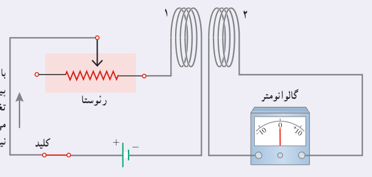
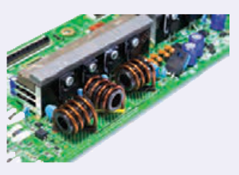

### خوب است بدانید: القای متقابل

شکل زیر اسباب آزمایش ساده‌ای را برای بررسی اثر القای متقابل نشان می‌دهد. جریان عبوری از پیچۀ ۱، میدان مغناطیسی $\vec B$ را به وجود می‌آورد. این میدان $\vec B$، شار مغناطیسی‌ای را از پیچۀ ۲ می‌گذراند که در مجاورت آن قرار دارد. با تغییر دادن مقاومت رئوستا و تغییر جریان در پیچۀ ۱، میدان مغناطیسی پیچۀ ۱ و در نتیجه شار عبوری از پیچۀ ۲ نیز تغییر می‌کند؛ بنابر قانون فاراده، این تغییر شار، نیروی محرکه‌ای را در پیچۀ ۲ القا می‌کند که به ایجاد جریان القایی در این پیچه می‌انجامد. همچنین تغییر جریان در پیچۀ ۲، سبب ایجاد نیروی محرکۀ القایی در پیچۀ ۱ می‌شود. این فرایند، **القای متقابل** نامیده می‌شود و به کمک آن می‌توان انرژی را از یک پیچه، به پیچۀ دیگر منتقل کرد.

با تغییر مقاومت رئوستا و تغییر جریان عبوری از پیچۀ ۱ شار عبوری از پیچۀ ۲ نیز تغییر می‌کند. این تغییر شار، سبب ایجاد نیروی محرکۀ القایی در پیچۀ ۲ می‌شود. همزمان تغییر جریان در پیچۀ ۲، سبب ایجاد نیروی محرکۀ القایی در پیچۀ ۱ می‌گردد.

در برخی از مدارهایی که از چندین القاگر به وجود آمده است، تغییرات جریان در یک القاگر می‌تواند نیروهای محرکۀ ناخواسته‌ای را در القاگرهای مجاور القا کند. به همین دلیل، در برخی از مدارهای الکتریکی، القای متقابل می‌تواند مزاحم باشد. برای هرچه کمتر کردن این اثر ناخواسته، باید سطح حلقه‌های القاگرهای مجاور را به طور عمود بر یکدیگر قرار داد (شکل روبه‌رو). در این صورت، اثر القای متقابل تا حد امکان کوچک می‌شود. القای متقابل کاربردهای مفید بسیاری نیز دارد. مثلاً در مبدل‌ها که در پایان همین فصل با آنها آشنا خواهید شد، القای متقابل، نقش مهمی در مقدار ولتاژ خروجی مبدل ایفا می‌کند.

برای به حداقل رساندن اثر القای متقابل در برخی از مدارهای الکتریکی، القاگرهای مجاور را به گونه‌ای قرار می‌دهند که سطح حلقه‌های آنها بر یکدیگر عمود باشند.

**انرژی ذخیره شده در القاگر در پدیدۀ خود ـ القاوری:** وقتی توسط باتری جریانی در القاگر برقرار شود، مولد به القاگر انرژی می‌دهد. بخشی از این انرژی در مقاومت الکتریکی سیم‌های القاگر به صورت گرما تلف و بقیۀ آن در میدان مغناطیسی القاگر ذخیره می‌شود. مقدار انرژی ذخیره شده در میدان القاگر با ضریب القاوری $L$، از رابطۀ زیر به‌دست می‌آید:

$$U=\frac12 LI^2\qquad (۳ـ۸)$$
