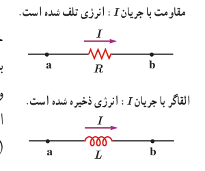
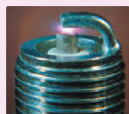

لازم است رفتار مقاومت و القاگر را به لحاظ انرژی اشتباه نگیرید (شکل ۳ـ۳۱). هنگام عبور جریان از مقاومت، انرژی وارد آن می‌شود. جریان چه پایا باشد و چه تغییر کند، این انرژی در مقاومت به انرژی گرمایی تبدیل می‌شود؛ درحالی‌که در یک القاگر آرمانی (با مقاومت صفر) تنها وقتی انرژی وارد القاگر می‌شود که جریان در آن افزایش یابد. این انرژی تلف نمی‌شود؛ بلکه در میدان مغناطیسی القاگر ذخیره شده و هنگام کاهش جریان، آزاد می‌شود. هنگام عبور جریان پایا از یک القاگر آرمانی (سیم‌پیچ بدون مقاومت)، انرژی به آن وارد یا از آن خارج نمی‌شود.

شکل ۳ـ۳۱ مقاومت قطعه‌ای است که در آن انرژی به طور غیرقابل برگشت تلف می‌شود. برخلاف آن، انرژی ذخیره شده در القاگر حامل جریان را می‌توان هنگام کاهش جریان، بازیافت.

### مثال ۳ـ۷

متخصصان صنعت برق، علاقه‌مندند راه‌های مؤثری را برای ذخیرۀ انرژی الکتریکی تولیدی در ساعت‌های کم‌مصرف (کم‌باری) بیابند تا با استفاده از آن، نیاز مشترکان را در ساعت‌های پرمصرف (اوج بار) تأمین کنند. یک ایدۀ فرضی، استفاده از یک القاگر بزرگ است. ضریب القاوری این القاگر چقدر باشد تا بتواند $1.0\,\mathrm{kWh}$ انرژی الکتریکی را در پیچۀ حامل جریان $200\,\mathrm A$ ذخیره کند؟

**پاسخ:** مقدار انرژی ذخیره شده مورد نیاز $U=1.0\,\mathrm{kWh}$ و جریان $I=200\,\mathrm A$ داده شده است. از معادلۀ ۳ـ۸ ضریب القاوری را به‌دست می‌آوریم:

$$U=1.0\,\mathrm{kWh}=(1.0\times10^3\,\mathrm W)(3600\,\mathrm s)=3.6\times10^6\,\mathrm J$$
$$U=\frac12 LI^2\Rightarrow L=\frac{2U}{I^2}=\frac{2(3.6\times10^6\,\mathrm J)}{(200\,\mathrm A)^2}=1.8\times10^2\,\mathrm H$$

ضریب القاوری به‌دست آمده، بسیار بیشتر از ضریب القاوری یک القاگر معمولی (در حد میلی‌هانری) است که در آزمایشگاه از آن استفاده می‌کنیم. افزون بر این همان‌طور که در فصل ۲ دیدیم سیم‌های معمولی که بتوانند جریان ۲۰۰ A را از خود عبور دهند باید قطر بسیار بزرگی داشته باشند. اندازۀ یک القاگر ۱۸۰ H که از سیم‌های معمولی ساخته شده باشد و بتواند چنین جریانی را تحمل کند باید خیلی بزرگ (به اندازۀ یک اتاق بزرگ) باشد. با توجه به فناوری‌های موجود، این ایدۀ غیرعملی است و توجیه اقتصادی ندارد.

### فناوری و کاربرد: انرژی لازم برای جرقه زدن شمع خودرو

انرژی ذخیره شده در میدان مغناطیسی نقش مؤثری در دستگاه‌های احتراق خودروهای با موتور بنزینی دارد. پیچۀ اولیه با حدود ۲۵۰ دور به باتری خودرو بسته شده است و میدان مغناطیسی قوی‌ای تولید می‌کند. این پیچه، درون یک پیچۀ ثانویه با ۲۵۰۰۰ دور سیم خیلی نازک قرار گرفته است. برای جرقه زدن شمع، جریان در پیچۀ اولیه قطع می‌شود و میدان مغناطیسی به سرعت به صفر می‌رسد و نیروی محرکۀ الکتریکی ده‌ها هزار ولتی در پیچۀ ثانویه القا می‌کند. در نتیجه انرژی ذخیره شده در میدان مغناطیسی همراه با جریانی لحظه‌ای از پیچۀ ثانویه به طرف شمع می‌رود و جرقه‌ای تولید می‌کند که سبب احتراق مخلوط سوخت و هوا در سیلندرهای موتور می‌شود (شکل روبه‌رو).

انرژی لازم برای جرقه زدن شمع خودرو، از انرژی ذخیره شده در میدان مغناطیسی پیچۀ احتراق تأمین می‌شود.
