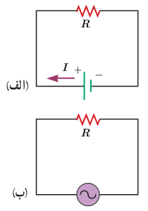
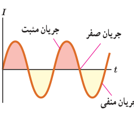
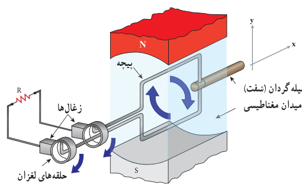

## ۳ـ۱۱ جریان متناوب

در اواخر قرن نوزدهم، بحث‌های داغی بین توماس ادیسون و جورج وستینگهاوس دربارۀ بهترین روش انتقال انرژی الکتریکی از محل تولید تا محل مصرف صورت گرفت. ادیسون موافق جریان مستقیم (dc) بود، در حالی که وستینگهاوس از جریان متناوب (ac) حمایت می‌کرد. سرانجام، وستینگهاوس پیروز شد و پس از آن سامانه‌های انتقال و توزیع برق و بیشتر وسایل خانگی با جریان متناوب به کار افتادند.

شکل ۳ـ۳۲ دو مدار سادۀ جریان مستقیم و جریان متناوب را نشان می‌دهد. همان‌طور که می‌بینید جهت جریان در مدار جریان مستقیم معین است، درحالی‌که در مدار جریان متناوب، به دلیل تغییر جهت جریان با گذشت زمان، نمی‌توان جهت معینی را برای جریان در نظر گرفت. تمامی نیروگاه‌های تولید برق در دنیا و از جمله ایران، جریان متناوبی تولید می‌کنند که تابعی سینوسی از زمان است و به همین دلیل، جریان متناوب سینوسی نامیده می‌شود (شکل ۳ـ۳۳).

شکل ۳ـ۳۲ الف) مدار سادۀ جریان مستقیم، که در آن جریان با گذشت زمان تغییر نمی‌کند. ب) مدار سادۀ جریان متناوب، که در آن ولتاژ و جریان با گذشت زمان به طور سینوسی تغییر می‌کنند.

شکل ۳ـ۳۳ جریان متناوب سینوسی، متداول‌ترین نوع جریان متناوب است.

**تولید جریان متناوب:** یکی از کاربردهای مهم اثر القای الکترومغناطیسی، تولید جریان متناوب است. پیش از این دیدیم که برای تولید نیروی محرکۀ القایی باید شار عبوری از پیچه تغییر کند. رایج‌ترین روش برای تغییر شار و در نتیجه تولید جریان القایی، تغییر زاویۀ $\theta$ در رابطۀ شار مغناطیسی، یعنی $\Phi=BA\cos\theta$ است. شکل ۳ـ۳۴ پیچه‌ای را نشان می‌دهد که می‌تواند در میدان مغناطیسی یکنواخت دور محور $x$ بچرخد.

شکل ۳ـ۳۴ اجزای یک مولد (ژنراتور) جریان متناوب. حرکت مکانیکی از طریق میلۀ گردان، سبب چرخیدن پیچه در میدان مغناطیسی می‌شود و جریان متناوبی را در مدار به وجود می‌آورد.

هر دور چرخش پیچه، معادل $2\pi$ رادیان است. اگر پیچه به‌طور یکنواخت بچرخد و هر دور چرخش آن $T$ ثانیه طول بکشد، پیچه در مدت $t$ ثانیه، به اندازۀ $t/T$ دور خواهد چرخید. در نتیجه اگر سطح پیچه در لحظۀ $t=0$ عمود بر میدان مغناطیسی باشد ($\theta=0$)، پس از گذشت $t$ ثانیه، زاویۀ $\theta$ برابر $(2\pi)(t/T)$ رادیان است. زمان یک دور چرخش کامل پیچه $(T)$ را **دوره یا زمان تناوب** می‌نامند. شاری که در لحظۀ $t$ از پیچه می‌گذرد برابر است با

$$\Phi=BA\cos\frac{2\pi}{T}t\qquad (۳ـ۹)$$
