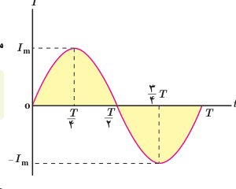
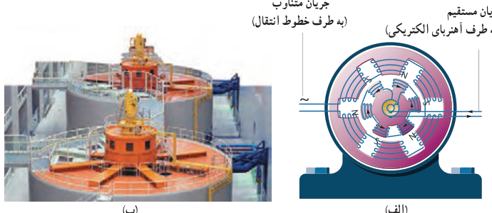
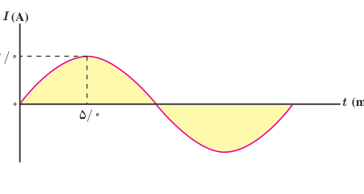

می‌توان نشان داد با تغییر شار مغناطیسی، جریانی که در پیچه القا می‌شود، از رابطۀ زیر به‌دست می‌آید¹:

$$I=I_m\sin\frac{2\pi}{T}t\qquad (۳ـ۱۰)$$

در این رابطه $I_m$ بیشینۀ جریان القا شده در پیچه است. رابطۀ ۳ـ۱۰ همچنین نشان می‌دهد که جریان القایی در پیچه، به‌طور سینوسی تغییر می‌کند، به‌همین سبب به آن **جریان متناوب** می‌گویند. نمودار این جریان برحسب زمان، در یک دوره در شکل ۳ـ۳۵ رسم شده است.

در نیروگاه‌های تولید برق، برای تولید جریان متناوب از مولدهای خاصی استفاده می‌شود که به آنها مولدهای صنعتی جریان متناوب می‌گویند. در مولدهای صنعتی پیچه‌ها ساکن‌اند و آهنربای الکتریکی در آنها می‌چرخد (شکل ۳ـ۳۶). در نیروگاه‌های تولید برق در ایران، آهنربای الکتریکی در هر ثانیه، ۵۰ دور درون پیچه می‌چرخد. این کمیت را بسامد برق تولید شده می‌نامند و به‌صورت $50\,\mathrm{Hz}$ بیان می‌کنند. یکای SI بسامد $\mathrm{s^{-1}}$ یا Hz (هرتز) است.

شکل ۳ـ۳۶ الف) در مولدهای صنعتی با چرخیدن آهنربای الکتریکی بین پیچه‌ها، جریان متناوب تولید می‌شود. ب) نمایی از مولدهای صنعتی تولید برق.

### مثال ۳ـ۸

شکل روبه‌رو، نمودار جریان متناوب سینوسی را نشان می‌دهد که یک مولد جریان متناوب تولید کرده است. معادلۀ جریان برحسب زمان را بنویسید.

**پاسخ:** چون ربع چرخش در $5.0\,\mathrm{ms}$ طی شده است، دورۀ تناوب برابر $T=20\,\mathrm{ms}$ است. همچنین با توجه به نمودار، بیشینۀ جریان $I_m=4.0\,\mathrm A$ است. در نتیجه از رابطۀ ۳ـ۱۰ داریم:

$$I=I_m\sin\frac{2\pi}{T}t=(4.0\,\mathrm A)\sin\left(\frac{2\pi}{20\times10^{-3}\,\mathrm s}\right)t=4.0\sin100\pi t$$

نتیجۀ نهایی برحسب یکاهای SI نوشته شده است.

۱ـ اثبات این رابطه، خارج از اهداف برنامۀ درسی این کتاب است.
