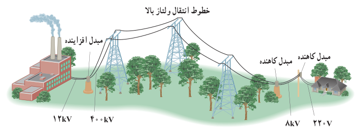

### تمرین ۳ـ۶

معادلۀ جریان ـ زمان یک مولد جریان متناوب برحسب یکاهای SI به‌صورت $I=(4.0\times10^{-3})\sin250\pi t$ است.

الف) جریان در دو لحظۀ $t_1=2.0\,\mathrm{ms}$ و $t_2=8.0\,\mathrm{ms}$ چقدر است؟

ب) دورۀ تناوب جریان را به‌دست آورید و نمودار جریان ـ زمان را در یک دورۀ کامل رسم کنید.

**مبدل‌ها:** یکی از مزیت‌های مهم توزیع توان الکتریکی ac بر dc آن است که افزایش و کاهش ولتاژ ac، بسیار آسان‌تر از dc است. برای انتقال توان الکتریکی در فاصله‌های دور، تا جایی که امکان دارد باید از ولتاژهای بالا و جریان‌های کم استفاده کنیم. این کار اتلاف توان را در خط‌های انتقال کاهش می‌دهد. همچنین با توجه به کاهش جریان می‌توان از سیم‌های نازک‌تری استفاده و در مصرف مواد اولیۀ ساخت سیم صرفه‌جویی کرد.

خط‌های انتقال توان الکتریکی به طور معمول از ولتاژهایی در حدود $400\,\mathrm{kV}$ استفاده می‌کنند (شکل ۳ـ۳۷). از طرف دیگر، ملاحظات ایمنی و الزامات عایق‌بندی در ساخت وسایل خانگی و صنعتی، ولتاژهای به نسبت پایین‌تری را در محل مصرف انرژی ضروری می‌کند. ولتاژ استاندارد برای سیم‌کشی خانگی در ایران و بسیاری از کشورهای دیگر ۲۲۰ V است. تبدیل ولتاژ مورد نیاز با استفاده از مبدل‌ها صورت می‌گیرد.

شکل ۳ـ۳۷ قبل از انتقال توان الکتریکی از نیروگاه‌ها، مبدل‌های افزاینده، ولتاژ را تا حدود ۴۰۰ kV افزایش می‌دهند. در انتهای مسیر، مبدل‌های کاهنده، ولتاژ را کاهش می‌دهند تا توان الکتریکی با امنیت بیشتر به محل مصرف برسد.
