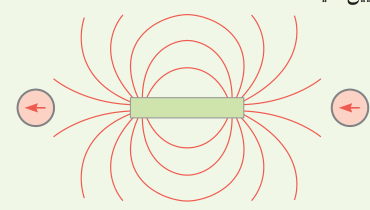
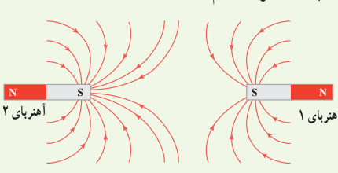
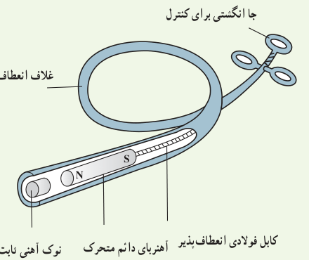
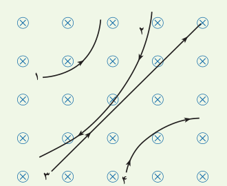
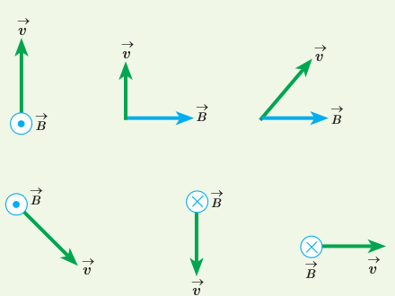

# پرسش‌ها و مسئله‌های فصل ۳

## ۳ـ۱ و ۳ـ۲ مغناطیس و قطب‌های مغناطیسی و میدان مغناطیسی

۱. با توجه به جهت‌گیری عقربه‌های مغناطیسی در شکل زیر، قطب‌های آهنربای میله‌ای و جهت خط‌های میدان مغناطیسی را تعیین کنید.

۲. الف) آهنربای میله‌ای با قطب‌های نامشخص در اختیار داریم. دست کم دو روش را برای تعیین قطب‌های این آهنربا بیان کنید.

ب) خط‌های میدان مغناطیسی بین دو آهنربا در شکل زیر نشان داده شده است. اندازۀ میدان مغناطیسی را در نزدیکی قطب‌های آهنرباها با هم مقایسه کنید.

۳. کودکی یک قطعۀ کوچک آهنی را بلعیده است. پزشک می‌خواهد آن را با دستگاه شکل زیر بیرون بیاورد.

الف) هنگامی که آهنربای دائمی به نوک ثابت آهنی نزدیک می‌شود چه اتفاقی می‌افتد؟

ب) ساختن نوک ثابت آهنی چه مزیتی دارد؟

پ) این وسیله را باید به درون گلوی کودک وارد و به سوی فلز بلعیده شده هدایت کرد؛ چرا غلاف باید انعطاف‌پذیر باشد؟

ت) پزشک می‌خواهد یک گیرۀ آهنی کاغذ و یک واشر آلومینیمی را از گلوی کودک بیرون بیاورد؛ کدام‌یک را می‌توان بیرون آورد؟ چرا؟

## ۳ـ۳ نیروی مغناطیسی وارد بر ذرۀ باردار متحرک در میدان مغناطیسی

۴. چهار ذره هنگام عبور از میدان مغناطیسی درون‌سو مسیرهای مطابق شکل زیر می‌پیمایند. دربارۀ نوع بار هر ذره چه می‌توان گفت؟

۵. جهت نیروی مغناطیسی وارد بر بار مثبت را در هریک از حالت‌های نشان داده شده در شکل زیر تعیین کنید.

