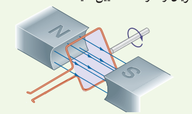
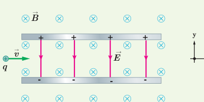
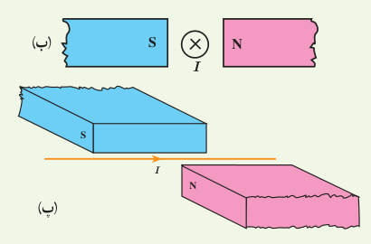
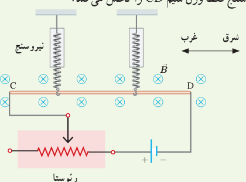
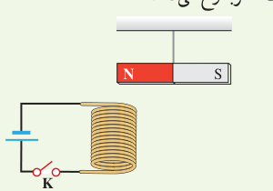

۶. حلقۀ رسانای مستطیل شکلی که حامل جریان $I$ است، بر اثر نیروی مغناطیسی وارد بر ضلع‌های حامل جریان حلقه، مطابق شکل درون میدان مغناطیسی یکنواخت می‌چرخد. جهت جریان را در حلقه تعیین کنید.

۷. پروتونی با تندی $4.4\times10^6\,\mathrm{m/s}$ درون میدان مغناطیسی یکنواختی به اندازۀ $18\,\mathrm{mT}$ در حرکت است. جهت حرکت پروتون با جهت $\vec B$، زاویۀ ۶۰° می‌سازد.

الف) اندازۀ نیروی وارد بر این پروتون را محاسبه کنید.

ب) اگر تنها این نیرو بر پروتون وارد شود، شتاب پروتون را حساب کنید. (بار الکتریکی پروتون $1.6\times10^{-19}\,\mathrm C$ و جرم آن را $1.7\times10^{-27}\,\mathrm{kg}$ در نظر بگیرید.)

۸. ذرۀ باردار مثبتی با جرم ناچیز و با سرعت $\vec v$ در امتداد محور $x$ وارد فضایی می‌شود که میدان‌های یکنواخت $\vec E$ و $\vec B$ وجود دارد (شکل زیر). اندازۀ این میدان‌ها برابر $E=450\,\mathrm{N/C}$ و $B=0.18\,\mathrm T$ است. تندی ذره چقدر باشد تا در همان امتداد محور $x$ به حرکت خود ادامه دهد؟

## ۳ـ۴ نیروی مغناطیسی وارد بر سیم حامل جریان

۹. جهت نیروی مغناطیسی وارد بر سیم حامل جریان را در هر یک از شکل‌های الف، ب و پ با استفاده از قاعدۀ دست راست بیابید.

۱۰. یک سیم حامل جریان $1.0\,\mathrm A$ مطابق شکل زیر با دو نیروسنج فنری که به دو انتهای آن بسته شده‌اند، به‌طور افقی و در راستای غرب ـ شرق قرار دارد. میدان مغناطیسی یکنواختی به‌طرف شمال و اندازۀ $0.050\,\mathrm T$ ایجاد می‌کنیم.

الف) اندازۀ نیروی مغناطیسی وارد بر ۲۰ سانتی‌متر این سیم را پیدا کنید.

ب) اگر بخواهیم نیروسنج‌ها عدد صفر را نشان دهند، چه جریانی و در چه جهتی باید از سیم عبور کند؟ جرم هر متر از طول این سیم ۸ گرم است ($g=9.8\,\mathrm{N/kg}$). فرض کنید نیروسنج فقط وزن سیم CD را تحمل می‌کند.

## ۳ـ۵ میدان مغناطیسی حاصل از جریان الکتریکی

۱۱. یک آهنربای میله‌ای مطابق شکل زیر، بالای سیم‌لوله‌ای آویزان شده است. توضیح دهید با بستن کلید K چه تغییری در وضعیت آهنربا رخ می‌دهد.

